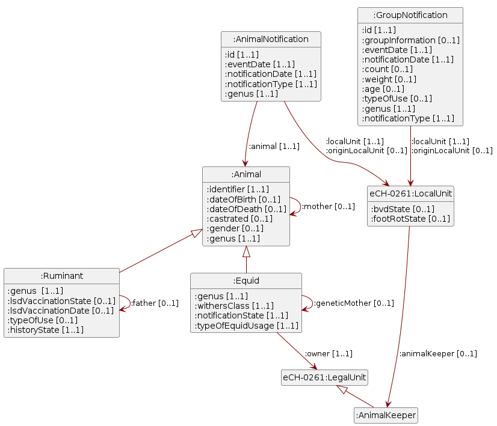

# Tierverkehrsdaten

5. November 2026

- [Hinweis](#sec-note)
- [1
  Einleitung](#sec-introduction)
  - [1.1 Status](#sec-status)
  - [1.2
    Anwendungsgebiet](#sec-scope-of-application)
  - [1.3 Das Tiermeldewesen in
    der Schweiz](#sec-animal-movement-reporting)
  - [1.4
    Verweise](#sec-references)
- [2
  Namespaces](#sec-namespaces)
- [3
  Datenmodell](#sec-data-model)
  - [3.1 Rechtliche
    Einheit](#sec-nodeshape-legalunit)
  - [3.2
    Tierhaltender](#sec-nodeshape-animalkeeper)
  - [3.3 Örtliche
    Einheit](#sec-nodeshape-localunit)
  - [3.4
    Einzeltier](#sec-nodeshape-animal)
  - [3.5
    Wiederkäuer](#sec-nodeshape-ruminant)
  - [3.6
    Equide](#sec-nodeshape-equid)
  - [3.7 Meldung
    Einzeltier](#sec-nodeshape-animalnotification)
  - [3.8
    Gruppenmeldung](#sec-nodeshape-groupnotification)
- [4
  Wertebereiche](#sec-code-lists)
  - [4.1
    Bewegungstyp](#sec-codelist-notificationtype)
  - [4.2
    Geschlecht](#sec-codelist-gender)
  - [4.3
    Grössenkategorie](#sec-codelist-equidwithersclass)
  - [4.4 Meldestatus
    Equide](#sec-codelist-equidnotificationstate)
  - [4.5
    Nutztierart](#sec-codelist-genus)
  - [4.6
    Tiergeschichtestatus](#sec-codelist-animalhistorystate)
  - [4.7 Zweck
    (Equiden)](#sec-codelist-equidtypeofusage)
  - [4.8 Zweck (Rinder, Schafe,
    Ziegen)](#sec-codelist-animaltypeofuse)
- [5
  Sicherheitsaspekte](#sec-safety-consideration)
- [6
  Haftungsausschluss](#sec-disclaimer)
- [7
  Urheberrechte](#sec-copyrights)
- [8 Anhang A -
  Referenzen](#sec-appendix-a)
- [9 Anhang B - Mitwirkung und
  Prüfung](#sec-appendix-b)
- [10 Anhang C - Abkürzungen und
  Glossar](#sec-appendix-c)
- [11 Anhang D - Abbildung auf
  die TVD-Schnittstelle](#sec-appendix-d)
- [12 Anhang E - Änderungen
  gegenüber der Vorversion](#sec-appendix-e)
- [13 Anhang F -
  Abbildungsverzeichnis](#sec-appendix-f)
- [14 Anhang G -
  Tabellenverzeichnis](#sec-appendix-g)

# Hinweis

Im vorliegenden Dokument wird bei der Bezeichnung von Personen eine
geschlechtsneutrale Formulierung verwendet. Basis bildet der Leitfaden
der Bundeskanzlei. Je nach Situation kommen Paarformen (Bürgerinnen und
Bürger), geschlechtsabstrakte Formen (versicherte Person),
geschlechtsneutrale Formen (Versicherte) oder Umschreibungen ohne
Personenbezug zum Einsatz. Das generische Maskulin (Bürger) ist nicht
zulässig. Vollformen werden in fortlaufenden Texten verwendet, also in
Texten, die aus ausformulierten Sätzen bestehen. In verknappten
Textpassagen, namentlich in Tabellen, können Kurzformen verwendet
werden. Dabei wird die Kurzform mit Schrägstrich, aber ohne
Auslassungsstrich verwendet (Referent/in). Genderstern und ähnliche
Schreibweisen werden nicht verwendet.

# Einleitung

## Status

In Arbeit: Der Gebrauch ist nur innerhalb der Fachgruppe, bzw. im
Expertenausschuss zugelassen.

## Anwendungsgebiet

Das vorliegende Dokument beschreibt die Daten der Tierverkehrsdatenbank
(TVD) semantisch, um auch Fachpersonen ohne vertiefte IT-Kenntnisse ein
besseres Verständnis der Daten zu ermöglichen.

## Das Tiermeldewesen in der Schweiz

Die Land- und Ernährungswirtschaft in der Schweiz wurde in den 1990er
Jahren stark durch die Tierseuche «BSE» herausgefordert. Als sich 1996
die Erkenntnis der Übertragbarkeit der Krankheit vom Tier auf den
Menschen erhärtete, führte dies zu grosser Verunsicherung. In der Folge
stiegen die Erwartungen an die Sicherheit von tierischen Lebensmitteln
und das Bewusstsein für die Bedeutung der Lebensmittelkontrolle. Der
Ansatz «vom Stall bis auf den Teller» etablierte sich. Die
risikobasierte Überwachung, die lückenlose Rückverfolgbarkeit der
Nutztiere, die Kontrolle des Tierverkehrs, die Pflicht zur
Herkunftsdeklaration sowie Qualitätskontrollen in der gesamten
Produktions- und Verarbeitungskette bilden seither die Basis für einen
hohen Standard in der Lebensmittelsicherheit \[Bundesrat 2015\].

Die Erfahrung BSE führte 1999 zum Aufbau einer nationalen
Tierverkehrsdatenbank (TVD). In Artikel 7a sowie 13–15 des
Tierseuchengesetzes \[TSG\] und in Titel 2, Abschnitt 1, 1a und 2a der
Tierseuchenverordnung \[TSV\] sind die grundlegenden gesetzlichen
Ausführungen zur Identifizierung/Kennzeichnung und der Registrierung von
Nutztieren sowie die zugehörigen Meldepflichten formuliert. Diese
orientieren sich an der europäischen Gesetzgebung zur selben Thematik
\[EUR-Lex\] (Verordnung (EU) 2016/429 zu Tierseuchen; Delegierte
Verordnung (EU) 2019/2035 über Betriebe, in denen Landtiere gehalten
werden, und für Brütereien sowie zur Rückverfolgbarkeit).

Waren ab 1999 vorerst Rinder meldepflichtig, folgten ab 2011 die
Schweine und Equiden, wenn auch die Schweine bis heute nicht in Form von
Einzeltiermeldungen. Ab 2014, respektive 2020 galt die Meldepflicht in
die TVD dann auch für Kleinwiederkäuer (Schafe und Ziegen). Zu Beginn,
2014, betraf diese nur die Schlachtbetriebe. Seit 2014 besteht auch die
Meldepflicht für Geflügel \[TVD-Verordnung, Fassung vom 1. Januar 2014,
S. 20\]. Seit dem Januar 2020 sind auch die Tierhaltenden von
Kleinwiederkäuern in das Meldewesen der Einzeltiere eingebunden
\[IdTVD-V, Anhang 1\]. Die Identifizierung und Kennzeichnung der
Klauentiere mit Ohrmarken, die Einzeltierregistrierung von Rindern,
Schafen und Ziegen in der TVD, sowie die Meldung von Tierzugängen,
Tierabgängen (Tier verlässt eine Tierhaltung lebend), Geburten, Einfuhr,
Ausfuhr, Schlachtung, Hofschlachtung und Verendung (Tier wird als nicht
mehr lebend abgemeldet), sind für alle Tierhaltenden in der Schweiz
obligatorisch \[TSG, Art. 14 und 15a\]. Die Meldungen unterliegen zudem
gesetzlichen Meldefristen \[TSV, Art. 14\].

Die TVD ist Teil einer Systemlandschaft der Bereiche Landwirtschaft,
Veterinärwesen und Lebensmittelsicherheit. Die zentrale Eingangspforte
bildet dabei das Portal Agate \[Agate\], mit dem Agrarpolitischen
Informationssystem AGIS \[AGIS\] im Zentrum.

<!-- Abbildung «Systemlandschaft und Datenflüsse» wird nachgeliefert. -->

In der Verordnung über die Identitas AG und die Tierverkehrsdatenbank
\[IdTVD-V\] werden Inhalte zum Tierverkehr und Aufgaben der Identitas AG
sowie die Zugriffsrechte auf die Daten weiter ausgeführt. Die Bedeutung
der Identifizierung/Kennzeichnung von Nutztieren geht weit über die
Seuchenthematik hinaus und fand deshalb auch Eingang in die
landwirtschaftliche Gesetzgebung \[LwG\] (Landwirtschaftsgesetz LwG
Artikel 165g, 177 und 185) und diverse zugehörige Verordnungen. Die
Daten aus dem Tierverkehr entwickelten sich zu einem unverzichtbaren
Bestandteil in der Umsetzung agrarpolitischer Massnahmen, beispielsweise
der tierbezogenen Direktzahlungen \[DZV, Titel 2, Kapitel 5, Abschnitte
7–9\], der Bestimmung der Nährstoffflüsse oder des
Agrarumweltmonitorings \[Agrarumweltmonitoring\]. Weiter dienen die
Daten auch als Grundlage für die Strukturerhebung der Landwirtschaft in
der Schweiz \[STRU\] und generell der landwirtschaftlichen Statistik
\[Agristat\].

Rasch etablierte sich das Tiermeldewesen auch entlang der gesamten
Lebensmittelwertschöpfungskette. Programme mit Tierwohl-,
Rückverfolgbarkeits- und Herkunftsversprechen stützen sich darauf ab
\[Labelbase; Proviande\]. Die Vielfalt der Tierinformation aus dem
Meldewesen des Tierverkehrs spiegelt sich auch in den öffentlich
verfügbaren Datensätzen der Open Data Plattform Tierstatistik
\[Tierstatistik\].

Die technische Schnittstellenbeschreibung in diesem Dokument basiert auf
der technischen Servicebeschreibung AnimalTracing v1.32, sowie der
openAPI-Spezifikation v1.0 \[AnimalTracing openAPI\].

## Verweise

Schnittstellen: AnimalTracing API, Technische Servicebeschreibung
AnimalTracing

# Namespaces

<a href="#tbl-namespaces" class="quarto-xref">Tabelle 1</a> listet die
Präfixe und Namespaces, die in diesem Dokument verwendet werden. Ein
Präfix steht stellvertretend für eine Namespace-IRI, den gemeinsamen
Anfang der IRIs eines Vokabulars. Die Turtle-Spezifikation beschreibt,
wie solche [*Prefixed
Names*](https://www.w3.org/TR/turtle/#prefixed-name) aufgelöst werden
\[Turtle\].

Tabelle 1: In eCH-0309 – Tierverkehrsdaten verwendete Namespaces.

| Präfix    | Namespace                                            |
|:----------|:-----------------------------------------------------|
| :         | https://agriculture.ld.admin.ch/eCH-0309/1/          |
| codelist: | https://agriculture.ld.admin.ch/eCH-0309/1/codelist/ |
| eCH-0261: | http://www.ech.ch/xmlns/ech-0261/1/                  |
| genus:    | https://agriculture.ld.admin.ch/eCH-0309/1/genus/    |
| schema:   | http://schema.org/                                   |
| xsd:      | http://www.w3.org/2001/XMLSchema#                    |

# Datenmodell

Abbildung 1: UML-Diagramm des Datenmodells von eCH-0309.

<a href="#fig-uml" class="quarto-xref">Abbildung 1</a> zeigt die Klassen
des Datenmodells und ihre Beziehungen. Jedes Rechteck ist eine Klasse,
die Zeilen darin sind ihre Attribute; die eckigen Klammern geben an, wie
viele Werte zulässig sind, von der Mindest- bis zur Höchstzahl —
`[1..1]` bedeutet genau einen Wert, `[0..1]` höchstens einen. Ein Pfeil
führt zu der Klasse, auf die verwiesen wird, und trägt den Namen der
Beziehung; mehrere Beziehungen zwischen denselben Klassen teilen sich
einen Pfeil. Die Linie mit dem Dreieck verbindet eine Klasse mit ihrer
Oberklasse, auf die das Dreieck zeigt: Ein Wiederkäuer und ein Equide
sind je ein Einzeltier und haben zusätzlich zu den gezeigten alle
Attribute des Einzeltiers, die im Diagramm nicht wiederholt werden.
Attribute mit einem Wertebereich sind wie alle übrigen dargestellt; die
zulässigen Werte stehen in
<a href="#sec-code-lists" class="quarto-xref">Kapitel 4</a>. Datentypen
und Beschreibungen führt das Diagramm nicht auf, sie folgen in den
Abschnitten zu den einzelnen Klassen.

## Rechtliche Einheit

Die rechtliche Einheit nach eCH-0108 ist eine juristische Person (z.B.
Aktiengesellschaft, GmbH), eine Personengesellschaft (z.B.
Kollektivgesellschaft) oder eine selbstständigerwerbende natürliche
Person, die dem Bundesgesetz über die Unternehmens-Identifikationsnummer
(UIDG) unterstellt ist und einen Eintrag im UID-Register aufweist. Sie
identifiziert z.B. das Steuersubjekt für Steuerbehörden oder die
beitragspflichtige Person für Sozialversicherungsbeiträge. Die
rechtliche Einheit wird mit der UID identifiziert. Nur wenn das
Unternehmen ein «Einzelunternehmen» ist, ist der Bewirtschafter zugleich
eine natürliche Person. Das Mastersystem für diese Daten ist das
UID-Register des BFS; das landwirtschaftliche Informationssystem bezieht
die Daten aus diesem Register über eine Schnittstelle. Der Tierhaltende
und der Equideneigentümer sind die beiden Ausprägungen der rechtlichen
Einheit, die in diesem Hilfsmittel vorkommen. Die Attribute sind in
[eCH-0261](https://ech.ch/sites/default/files/imce/eCH-Dossier/eCH-Dossier_PDF_Publikationen/Hauptdokument/STAN_d_DEF_2024-02_07_eCH-0261_V1.0.0_Datenstandard_Agrardaten_Stammdaten.pdf),
Kapitel 3.1 und 3.2, sowie in
[eCH-0108](https://ech.ch/sites/default/files/imce/eCH-Dossier/eCH-Dossier_PDF_Publikationen/Hauptdokument/STAN_d_DEF_2023-12-21_eCH-0108_V6.0.0_Unternehmensstammdaten%20Unternehmensregister.pdf),
Kapitel 3.1, beschrieben.

### Übersicht

Klasse  
[eCH-0261:LegalUnit](http://www.ech.ch/xmlns/ech-0261/1/LegalUnit)

## Tierhaltender

Ein Bewirtschafter ist eine rechtliche Einheit nach eCH-0108, die das
Geschäftsrisiko für einen Betrieb trägt (LBV Art. 2). Der Tierhaltende
ist eine Form des Bewirtschafters, der Tiere hält (LBV Art. 11a); er
braucht somit eine örtliche Einheit (Tierhaltung). Die Verantwortung für
das Meldewesen obliegt dem Tierhaltenden für alle Tierkategorien mit
Ausnahme der Equiden; bei Equiden liegt sie beim Eigentümer oder bei der
Eigentümerin. Die Attribute sind in
[eCH-0261](https://ech.ch/sites/default/files/imce/eCH-Dossier/eCH-Dossier_PDF_Publikationen/Hauptdokument/STAN_d_DEF_2024-02_07_eCH-0261_V1.0.0_Datenstandard_Agrardaten_Stammdaten.pdf),
Kapitel 3.1 und 3.2, beschrieben.

### Übersicht

Klasse  
[:AnimalKeeper](https://agriculture.ld.admin.ch/eCH-0309/1/AnimalKeeper)

## Örtliche Einheit

Eine örtliche Einheit nach eCH-0108 ist eine Einrichtung an einem
bestimmten Ort, an welcher eine wirtschaftliche Tätigkeit ausgeübt wird.
Eine örtliche Einheit hat eine BUR-Nummer und ist immer einer
rechtlichen Einheit (bzw. einem Unternehmen) zugeordnet. Die örtliche
Einheit wird über die BUR-Nummer identifiziert. Die örtliche Einheit
kann aus einem oder mehreren Gebäuden bestehen. Die der BUR-Nummer
zugewiesene EGID bezieht sich auf «das Zentrum» der örtlichen Einheit,
resp. das Hauptgebäude. Diese Definition stammt aus
[eCH-0108](https://ech.ch/sites/default/files/imce/eCH-Dossier/eCH-Dossier_PDF_Publikationen/Hauptdokument/STAN_d_DEF_2023-12-21_eCH-0108_V6.0.0_Unternehmensstammdaten%20Unternehmensregister.pdf),
Kapitel 1.5; die agrarspezifischen Ergänzungen sind in
[eCH-0261](https://ech.ch/sites/default/files/imce/eCH-Dossier/eCH-Dossier_PDF_Publikationen/Hauptdokument/STAN_d_DEF_2024-02_07_eCH-0261_V1.0.0_Datenstandard_Agrardaten_Stammdaten.pdf),
Kapitel 3.3 und 3.4, beschrieben. In der TVD werden die örtlichen
Einheiten «Tierhaltungen» genannt und sind zusätzlich über die
TVD-Nummer identifiziert.

### Übersicht

Klasse  
[eCH-0261:LocalUnit](http://www.ech.ch/xmlns/ech-0261/1/LocalUnit)

### Eigenschaften

<table style="width:99%;">
<colgroup>
<col style="width: 50%" />
<col style="width: 38%" />
<col style="width: 9%" />
</colgroup>
<thead>
<tr>
<th style="text-align: left;">Beschreibung</th>
<th style="text-align: left;">Details</th>
<th style="text-align: right;">Kardinalität</th>
</tr>
</thead>
<tbody>
<tr>
<td style="text-align: left;"><strong>Tierhaltender</strong> (<a
href="https://agriculture.ld.admin.ch/eCH-0309/1/animalKeeper">:animalKeeper</a>):
Zuordnung der örtlichen Einheit zum Tierhaltenden. Nach eCH-0108,
Kapitel 1.5, ist eine örtliche Einheit immer einer rechtlichen Einheit
(bzw. einem Unternehmen) zugeordnet; die Stammdaten der örtlichen
Einheit führen dafür das optionale Merkmal «mainUid» mit der UID der
rechtlichen Haupteinheit. Da der Tierhaltende nur eine Sonderform der
rechtlichen Einheit ist, ist diese Zuordnung nicht zwingend.</td>
<td style="text-align: left;"><ul>
<li>Typ: <a href="#sec-nodeshape-animalkeeper">Tierhaltender</a></li>
</ul></td>
<td style="text-align: right;">0..1</td>
</tr>
<tr>
<td style="text-align: left;"><strong>BVD-Status</strong> (<a
href="https://agriculture.ld.admin.ch/eCH-0309/1/bvdState">:bvdState</a>):
BVD-Status der örtlichen Einheit, für die Gattung Rinder.</td>
<td style="text-align: left;"><ul>
<li>Typ: Zeichenkette (<a
href="http://www.w3.org/2001/XMLSchema#string">xsd:string</a>)</li>
<li>Werte: <code>Undefined</code>, <code>Blocked</code>,
<code>AnimalBlocked</code>, <code>NotBlocked</code>,
<code>ConditionalBlocked</code>, <code>BvdFree</code>,
<code>NotBvdFree</code>, <code>NotBvdFreeBlocked</code></li>
</ul></td>
<td style="text-align: right;">0..1</td>
</tr>
<tr>
<td style="text-align: left;"><strong>Moderhinkestatus</strong> (<a
href="https://agriculture.ld.admin.ch/eCH-0309/1/footRotState">:footRotState</a>):
Moderhinkestatus der örtlichen Einheit, für die Gattung Schafe.</td>
<td style="text-align: left;"><ul>
<li>Typ: Zeichenkette (<a
href="http://www.w3.org/2001/XMLSchema#string">xsd:string</a>)</li>
<li>Werte: <code>Undefined</code>, <code>Free</code>,
<code>NotTested</code>, <code>Blocked</code></li>
</ul></td>
<td style="text-align: right;">0..1</td>
</tr>
</tbody>
</table>

## Einzeltier

Ein einzeln identifiziertes Nutztier. In der Tierverkehrsdatenbank
werden Tiere der Kategorien Rinder, Schafe, Ziegen und Equiden als
Einzeltiere erfasst; sie werden über die Ohrmarkennummer, bei Equiden
über die UELN, eindeutig identifiziert. Für Schweine und Geflügel werden
keine Einzeltiere geführt, sondern ausschliesslich Gruppenmeldungen.
Jedes Einzeltier ist entweder ein Wiederkäuer (Rind, Schaf, Ziege) oder
ein Equide; diese Klasse beschreibt die Angaben, die für beide gelten.

### Übersicht

Klasse  
[:Animal](https://agriculture.ld.admin.ch/eCH-0309/1/Animal)

### Eigenschaften

<table style="width:99%;">
<colgroup>
<col style="width: 49%" />
<col style="width: 40%" />
<col style="width: 9%" />
</colgroup>
<thead>
<tr>
<th style="text-align: left;">Beschreibung</th>
<th style="text-align: left;">Details</th>
<th style="text-align: right;">Kardinalität</th>
</tr>
</thead>
<tbody>
<tr>
<td style="text-align: left;"><strong>Identifikation Mutter</strong> (<a
href="https://agriculture.ld.admin.ch/eCH-0309/1/mother">:mother</a>):
Ein Einzeltier hat höchstens ein Muttertier.</td>
<td style="text-align: left;"><ul>
<li>Typ: <a href="#sec-nodeshape-animal">Einzeltier</a></li>
</ul></td>
<td style="text-align: right;">0..1</td>
</tr>
<tr>
<td style="text-align: left;"><strong>Identifikator</strong> (<a
href="https://agriculture.ld.admin.ch/eCH-0309/1/identifier">:identifier</a>):
Ohrmarkennummer, bei Equiden UELN</td>
<td style="text-align: left;"><ul>
<li>Typ: Zeichenkette (<a
href="http://www.w3.org/2001/XMLSchema#string">xsd:string</a>)</li>
<li>Länge: ≤ 15 Zeichen</li>
</ul></td>
<td style="text-align: right;">1..1</td>
</tr>
<tr>
<td style="text-align: left;"><strong>Nutztierart</strong> (<a
href="https://agriculture.ld.admin.ch/eCH-0309/1/genus">:genus</a>)</td>
<td style="text-align: left;"><ul>
<li>Typ: <a
href="http://schema.org/CategoryCode">schema:CategoryCode</a>, siehe
Codeliste <a href="#sec-codelist-genus">Nutztierart</a></li>
</ul></td>
<td style="text-align: right;">1..1</td>
</tr>
<tr>
<td style="text-align: left;"><strong>Geschlecht</strong> (<a
href="https://agriculture.ld.admin.ch/eCH-0309/1/gender">:gender</a>)</td>
<td style="text-align: left;"><ul>
<li>Typ: <a
href="http://schema.org/CategoryCode">schema:CategoryCode</a>, siehe
Codeliste <a href="#sec-codelist-gender">Geschlecht</a></li>
</ul></td>
<td style="text-align: right;">0..1</td>
</tr>
<tr>
<td style="text-align: left;"><strong>Geburtsdatum</strong> (<a
href="https://agriculture.ld.admin.ch/eCH-0309/1/dateOfBirth">:dateOfBirth</a>)</td>
<td style="text-align: left;"><ul>
<li>Typ: Datum (<a
href="http://www.w3.org/2001/XMLSchema#date">xsd:date</a>)</li>
</ul></td>
<td style="text-align: right;">0..1</td>
</tr>
<tr>
<td style="text-align: left;"><strong>Todesdatum</strong> (<a
href="https://agriculture.ld.admin.ch/eCH-0309/1/dateOfDeath">:dateOfDeath</a>)</td>
<td style="text-align: left;"><ul>
<li>Typ: Datum (<a
href="http://www.w3.org/2001/XMLSchema#date">xsd:date</a>)</li>
</ul></td>
<td style="text-align: right;">0..1</td>
</tr>
<tr>
<td style="text-align: left;"><strong>Kastriert</strong> (<a
href="https://agriculture.ld.admin.ch/eCH-0309/1/castrated">:castrated</a>):
Gibt an, ob das Tier kastriert ist. Nur für Rinder und Equiden.</td>
<td style="text-align: left;"><ul>
<li>Typ: Wahrheitswert (<a
href="http://www.w3.org/2001/XMLSchema#boolean">xsd:boolean</a>)</li>
</ul></td>
<td style="text-align: right;">0..1</td>
</tr>
</tbody>
</table>

### Regeln

Jedes Einzeltier ist entweder ein Wiederkäuer oder ein Equide.

Kastriert wird nur für Rinder und Equiden geführt, nicht für Schafe und
Ziegen.

## Wiederkäuer

Subklasse der Klasse Einzeltier für Tiere der Nutztierarten Rinder,
Schafe und Ziegen. Alle Attribute der Klasse Einzeltier gelten auch für
Wiederkäuer; diese Klasse beschreibt die zusätzlichen Angaben, die für
Equiden nicht geführt werden.

### Übersicht

Klasse  
[:Ruminant](https://agriculture.ld.admin.ch/eCH-0309/1/Ruminant)

### Eigenschaften

<table style="width:99%;">
<colgroup>
<col style="width: 48%" />
<col style="width: 42%" />
<col style="width: 7%" />
</colgroup>
<thead>
<tr>
<th style="text-align: left;">Beschreibung</th>
<th style="text-align: left;">Details</th>
<th style="text-align: right;">Kardinalität</th>
</tr>
</thead>
<tbody>
<tr>
<td style="text-align: left;"><strong>Identifikation Vater</strong> (<a
href="https://agriculture.ld.admin.ch/eCH-0309/1/father">:father</a>):
Ein Wiederkäuer hat höchstens ein Vatertier.</td>
<td style="text-align: left;"><ul>
<li>Typ: <a href="#sec-nodeshape-ruminant">Wiederkäuer</a></li>
</ul></td>
<td style="text-align: right;">0..1</td>
</tr>
<tr>
<td style="text-align: left;"><strong>Nutztierart</strong> (<a
href="https://agriculture.ld.admin.ch/eCH-0309/1/genus">:genus</a>)</td>
<td style="text-align: left;"><ul>
<li>Werte:
<ul>
<li>Rindvieh (<a
href="https://agriculture.ld.admin.ch/eCH-0309/1/genus/Cattle">genus:Cattle</a>)</li>
<li>Schafe (<a
href="https://agriculture.ld.admin.ch/eCH-0309/1/genus/Sheep">genus:Sheep</a>)</li>
<li>Ziegen (<a
href="https://agriculture.ld.admin.ch/eCH-0309/1/genus/Goat">genus:Goat</a>)</li>
</ul></li>
</ul></td>
<td style="text-align: right;">1..1</td>
</tr>
<tr>
<td style="text-align: left;"><strong>TiergeschichteStatus</strong> (<a
href="https://agriculture.ld.admin.ch/eCH-0309/1/historyState">:historyState</a>):
Status der Tiergeschichte zum Abfragedatum.</td>
<td style="text-align: left;"><ul>
<li>Typ: <a
href="http://schema.org/CategoryCode">schema:CategoryCode</a>, siehe
Codeliste <a
href="#sec-codelist-animalhistorystate">Tiergeschichtestatus</a></li>
</ul></td>
<td style="text-align: right;">1..1</td>
</tr>
<tr>
<td style="text-align: left;"><strong>Zweck</strong> (<a
href="https://agriculture.ld.admin.ch/eCH-0309/1/typeOfUse">:typeOfUse</a>)</td>
<td style="text-align: left;"><ul>
<li>Typ: <a
href="http://schema.org/CategoryCode">schema:CategoryCode</a>, siehe
Codeliste <a href="#sec-codelist-animaltypeofuse">Zweck (Rinder, Schafe,
Ziegen)</a></li>
</ul></td>
<td style="text-align: right;">0..1</td>
</tr>
<tr>
<td style="text-align: left;"><strong>LSD-Impfstatus</strong> (<a
href="https://agriculture.ld.admin.ch/eCH-0309/1/lsdVaccinationState">:lsdVaccinationState</a>):
Impfstatus gegen die Lumpy Skin Disease (LSD). Nur für Rinder.</td>
<td style="text-align: left;"><ul>
<li>Typ: Zeichenkette (<a
href="http://www.w3.org/2001/XMLSchema#string">xsd:string</a>)</li>
<li>Werte: <code>Undefined</code>, <code>Vaccinated</code></li>
</ul></td>
<td style="text-align: right;">0..1</td>
</tr>
<tr>
<td style="text-align: left;"><strong>LSD-Impfdatum</strong> (<a
href="https://agriculture.ld.admin.ch/eCH-0309/1/lsdVaccinationDate">:lsdVaccinationDate</a>):
Datum der Impfung gegen die Lumpy Skin Disease (LSD). Nur für
Rinder.</td>
<td style="text-align: left;"><ul>
<li>Typ: Datum (<a
href="http://www.w3.org/2001/XMLSchema#date">xsd:date</a>)</li>
</ul></td>
<td style="text-align: right;">0..1</td>
</tr>
</tbody>
</table>

### Regeln

Der LSD-Impfstatus und das LSD-Impfdatum werden nur für Rinder geführt,
nicht für Schafe und Ziegen.

## Equide

Subklasse der Klasse Einzeltier für Tiere der Gattung Equiden (Pferd,
Maultier, Maulesel, Esel). Alle Attribute der Klasse Einzeltier gelten
auch für Equiden; diese Klasse beschreibt ausschliesslich die
zusätzlichen, equidenspezifischen Angaben. Die Verantwortung für das
Meldewesen liegt bei Equiden nicht beim Tierhaltenden, sondern bei der
Eigentümerin oder beim Eigentümer. Ein Eigentümer ist die rechtliche
Einheit, in deren Eigentum Equiden sind; der Begriff wird nur für
Equideneigentümer geführt.

### Übersicht

Klasse  
[:Equid](https://agriculture.ld.admin.ch/eCH-0309/1/Equid)

### Eigenschaften

<table style="width:99%;">
<colgroup>
<col style="width: 49%" />
<col style="width: 41%" />
<col style="width: 8%" />
</colgroup>
<thead>
<tr>
<th style="text-align: left;">Beschreibung</th>
<th style="text-align: left;">Details</th>
<th style="text-align: right;">Kardinalität</th>
</tr>
</thead>
<tbody>
<tr>
<td style="text-align: left;"><strong>Eigentümer oder
Eigentümerin</strong> (<a
href="https://agriculture.ld.admin.ch/eCH-0309/1/owner">:owner</a>): Die
rechtliche Einheit, in deren Eigentum der Equide steht. Bei Equiden
liegt die Verantwortung für das Meldewesen beim Eigentümer und nicht
beim Tierhaltenden.</td>
<td style="text-align: left;"><ul>
<li>Typ: <a href="#sec-nodeshape-legalunit">Rechtliche Einheit</a></li>
</ul></td>
<td style="text-align: right;">1..1</td>
</tr>
<tr>
<td style="text-align: left;"><strong>Identifikation genetische
Mutter</strong> (<a
href="https://agriculture.ld.admin.ch/eCH-0309/1/geneticMother">:geneticMother</a>):
Ein Equide hat höchstens eine genetische Mutter.</td>
<td style="text-align: left;"><ul>
<li>Typ: <a href="#sec-nodeshape-equid">Equide</a></li>
</ul></td>
<td style="text-align: right;">0..1</td>
</tr>
<tr>
<td style="text-align: left;"><strong>Nutztierart</strong> (<a
href="https://agriculture.ld.admin.ch/eCH-0309/1/genus">:genus</a>)</td>
<td style="text-align: left;"><ul>
<li>Pflichtwert: <a
href="https://agriculture.ld.admin.ch/eCH-0309/1/genus/Equid">genus:Equid</a></li>
</ul></td>
<td style="text-align: right;">1..1</td>
</tr>
<tr>
<td style="text-align: left;"><strong>Grössenkategorie</strong> (<a
href="https://agriculture.ld.admin.ch/eCH-0309/1/withersClass">:withersClass</a>)</td>
<td style="text-align: left;"><ul>
<li>Typ: <a
href="http://schema.org/CategoryCode">schema:CategoryCode</a>, siehe
Codeliste <a
href="#sec-codelist-equidwithersclass">Grössenkategorie</a></li>
</ul></td>
<td style="text-align: right;">1..1</td>
</tr>
<tr>
<td style="text-align: left;"><strong>Meldestatus</strong> (<a
href="https://agriculture.ld.admin.ch/eCH-0309/1/notificationState">:notificationState</a>):
Equiden führen anstelle des TiergeschichteStatus einen eigenen
Meldestatus.</td>
<td style="text-align: left;"><ul>
<li>Typ: <a
href="http://schema.org/CategoryCode">schema:CategoryCode</a>, siehe
Codeliste <a href="#sec-codelist-equidnotificationstate">Meldestatus
Equide</a></li>
</ul></td>
<td style="text-align: right;">1..1</td>
</tr>
<tr>
<td style="text-align: left;"><strong>Zweck</strong> (<a
href="https://agriculture.ld.admin.ch/eCH-0309/1/typeOfEquidUsage">:typeOfEquidUsage</a>):
Equiden verwenden einen eigenen Wertebereich: Heimtier oder
Nutztier.</td>
<td style="text-align: left;"><ul>
<li>Typ: <a
href="http://schema.org/CategoryCode">schema:CategoryCode</a>, siehe
Codeliste <a href="#sec-codelist-equidtypeofusage">Zweck
(Equiden)</a></li>
</ul></td>
<td style="text-align: right;">1..1</td>
</tr>
</tbody>
</table>

## Meldung Einzeltier

Ein Ereignis, das ein Einzeltier betrifft. Als Ereignisse gelten
Bewegungsmeldungen, Meldungen von Grunddaten, Änderungen einzelner
Attribute der Grunddaten sowie finale Meldungen. Eine Meldung bezieht
sich immer auf die örtliche Einheit, auf welcher das Ereignis
stattgefunden hat, und kann zusätzlich die örtliche Einheit der Herkunft
angeben. Die Ereignisse werden durch die berechtigten Personen gemeldet
mit Angabe der Tierhaltung, auf die sich die Meldung bezieht; bei
Equiden werden sie durch die berechtigten Personen des verantwortlichen
Equideneigentümers gemeldet.

### Übersicht

Klasse  
[:AnimalNotification](https://agriculture.ld.admin.ch/eCH-0309/1/AnimalNotification)

### Eigenschaften

<table style="width:99%;">
<colgroup>
<col style="width: 53%" />
<col style="width: 37%" />
<col style="width: 9%" />
</colgroup>
<thead>
<tr>
<th style="text-align: left;">Beschreibung</th>
<th style="text-align: left;">Details</th>
<th style="text-align: right;">Kardinalität</th>
</tr>
</thead>
<tbody>
<tr>
<td style="text-align: left;"><strong>Identifikator</strong> (<a
href="https://agriculture.ld.admin.ch/eCH-0309/1/animal">:animal</a>):
Eine Meldung Einzeltier bezieht sich auf genau ein Einzeltier.</td>
<td style="text-align: left;"><ul>
<li>Typ: <a href="#sec-nodeshape-animal">Einzeltier</a></li>
</ul></td>
<td style="text-align: right;">1..1</td>
</tr>
<tr>
<td style="text-align: left;"><strong>Örtliche Einheit</strong> (<a
href="https://agriculture.ld.admin.ch/eCH-0309/1/localUnit">:localUnit</a>):
BUR-Nummer der örtlichen Einheit, auf die sich die Meldung bezieht</td>
<td style="text-align: left;"><ul>
<li>Typ: <a href="#sec-nodeshape-localunit">Örtliche Einheit</a></li>
</ul></td>
<td style="text-align: right;">1..1</td>
</tr>
<tr>
<td style="text-align: left;"><strong>Herkunft</strong> (<a
href="https://agriculture.ld.admin.ch/eCH-0309/1/originLocalUnit">:originLocalUnit</a>):
BUR-Nummer der örtlichen Einheit von der das Tier kommt</td>
<td style="text-align: left;"><ul>
<li>Typ: <a href="#sec-nodeshape-localunit">Örtliche Einheit</a></li>
</ul></td>
<td style="text-align: right;">0..1</td>
</tr>
<tr>
<td style="text-align: left;"><strong>ID</strong> (<a
href="https://agriculture.ld.admin.ch/eCH-0309/1/id">:id</a>):
Eindeutiger Identifikator der Bewegung, der durch das System vergeben
wird.</td>
<td style="text-align: left;"><ul>
<li>Typ: Zeichenkette (<a
href="http://www.w3.org/2001/XMLSchema#string">xsd:string</a>)</li>
</ul></td>
<td style="text-align: right;">1..1</td>
</tr>
<tr>
<td style="text-align: left;"><strong>Nutztierart</strong> (<a
href="https://agriculture.ld.admin.ch/eCH-0309/1/genus">:genus</a>)</td>
<td style="text-align: left;"><ul>
<li>Typ: <a
href="http://schema.org/CategoryCode">schema:CategoryCode</a>, siehe
Codeliste <a href="#sec-codelist-genus">Nutztierart</a></li>
</ul></td>
<td style="text-align: right;">1..1</td>
</tr>
<tr>
<td style="text-align: left;"><strong>Meldungstyp</strong> (<a
href="https://agriculture.ld.admin.ch/eCH-0309/1/notificationType">:notificationType</a>)</td>
<td style="text-align: left;"><ul>
<li>Typ: <a
href="http://schema.org/CategoryCode">schema:CategoryCode</a>, siehe
Codeliste <a href="#sec-codelist-notificationtype">Bewegungstyp</a></li>
</ul></td>
<td style="text-align: right;">1..1</td>
</tr>
<tr>
<td style="text-align: left;"><strong>Ereignisdatum</strong> (<a
href="https://agriculture.ld.admin.ch/eCH-0309/1/eventDate">:eventDate</a>):
Datum, an dem das Ereignis stattgefunden hat</td>
<td style="text-align: left;"><ul>
<li>Typ: Datum (<a
href="http://www.w3.org/2001/XMLSchema#date">xsd:date</a>)</li>
</ul></td>
<td style="text-align: right;">1..1</td>
</tr>
<tr>
<td style="text-align: left;"><strong>Meldedatum</strong> (<a
href="https://agriculture.ld.admin.ch/eCH-0309/1/notificationDate">:notificationDate</a>):
Datum, an dem das Ereignis gemeldet wurde</td>
<td style="text-align: left;"><ul>
<li>Typ: Datum (<a
href="http://www.w3.org/2001/XMLSchema#date">xsd:date</a>)</li>
</ul></td>
<td style="text-align: right;">1..1</td>
</tr>
</tbody>
</table>

## Gruppenmeldung

Ein Ereignis für eine nicht eindeutig identifizierbare Tiergruppe.
Gruppenmeldungen werden für Tiere der Kategorien Schweine und Geflügel
erfasst; die Individuen einer Tiergruppe sind deshalb nicht bekannt. Die
Ereignisse werden durch die natürlichen Personen der verantwortlichen
rechtlichen Einheit Tierhaltender gemeldet. Sie umfassen
Einstallungsmeldungen bei Geflügel, Bewegungsmeldungen bei Schweinen
sowie Schlachtungsmeldungen von Schweinen (in Stück) und Geflügelgruppen
(in kg).

### Übersicht

Klasse  
[:GroupNotification](https://agriculture.ld.admin.ch/eCH-0309/1/GroupNotification)

### Eigenschaften

<table style="width:99%;">
<colgroup>
<col style="width: 52%" />
<col style="width: 37%" />
<col style="width: 9%" />
</colgroup>
<thead>
<tr>
<th style="text-align: left;">Beschreibung</th>
<th style="text-align: left;">Details</th>
<th style="text-align: right;">Kardinalität</th>
</tr>
</thead>
<tbody>
<tr>
<td style="text-align: left;"><strong>Örtliche Einheit</strong> (<a
href="https://agriculture.ld.admin.ch/eCH-0309/1/localUnit">:localUnit</a>):
BUR-Nummer der örtlichen Einheit</td>
<td style="text-align: left;"><ul>
<li>Typ: <a href="#sec-nodeshape-localunit">Örtliche Einheit</a></li>
</ul></td>
<td style="text-align: right;">1..1</td>
</tr>
<tr>
<td style="text-align: left;"><strong>Herkunft</strong> (<a
href="https://agriculture.ld.admin.ch/eCH-0309/1/originLocalUnit">:originLocalUnit</a>):
BUR-Nummer der örtlichen Einheit von der das Tier kommt</td>
<td style="text-align: left;"><ul>
<li>Typ: <a href="#sec-nodeshape-localunit">Örtliche Einheit</a></li>
</ul></td>
<td style="text-align: right;">0..1</td>
</tr>
<tr>
<td style="text-align: left;"><strong>ID</strong> (<a
href="https://agriculture.ld.admin.ch/eCH-0309/1/id">:id</a>):
Eindeutiger Identifikator der Bewegung, der durch das System vergeben
wird.</td>
<td style="text-align: left;"><ul>
<li>Typ: Zeichenkette (<a
href="http://www.w3.org/2001/XMLSchema#string">xsd:string</a>)</li>
</ul></td>
<td style="text-align: right;">1..1</td>
</tr>
<tr>
<td style="text-align: left;"><strong>Nutztierart</strong> (<a
href="https://agriculture.ld.admin.ch/eCH-0309/1/genus">:genus</a>)</td>
<td style="text-align: left;"><ul>
<li>Typ: <a
href="http://schema.org/CategoryCode">schema:CategoryCode</a>, siehe
Codeliste <a href="#sec-codelist-genus">Nutztierart</a></li>
</ul></td>
<td style="text-align: right;">1..1</td>
</tr>
<tr>
<td style="text-align: left;"><strong>Gruppeninformation</strong> (<a
href="https://agriculture.ld.admin.ch/eCH-0309/1/groupInformation">:groupInformation</a>):
Nur für Geflügel, nicht für Schweine: Bei Einstallungsmeldungen ist eine
Gruppeninformation anzugeben.</td>
<td style="text-align: left;"><ul>
<li>Typ: Zeichenkette (<a
href="http://www.w3.org/2001/XMLSchema#string">xsd:string</a>)</li>
</ul></td>
<td style="text-align: right;">0..1</td>
</tr>
<tr>
<td style="text-align: left;"><strong>Meldungstyp</strong> (<a
href="https://agriculture.ld.admin.ch/eCH-0309/1/notificationType">:notificationType</a>)</td>
<td style="text-align: left;"><ul>
<li>Typ: <a
href="http://schema.org/CategoryCode">schema:CategoryCode</a>, siehe
Codeliste <a href="#sec-codelist-notificationtype">Bewegungstyp</a></li>
</ul></td>
<td style="text-align: right;">1..1</td>
</tr>
<tr>
<td style="text-align: left;"><strong>Ereignisdatum</strong> (<a
href="https://agriculture.ld.admin.ch/eCH-0309/1/eventDate">:eventDate</a>):
Datum, an dem das Ereignis stattgefunden hat</td>
<td style="text-align: left;"><ul>
<li>Typ: Datum (<a
href="http://www.w3.org/2001/XMLSchema#date">xsd:date</a>)</li>
</ul></td>
<td style="text-align: right;">1..1</td>
</tr>
<tr>
<td style="text-align: left;"><strong>Meldedatum</strong> (<a
href="https://agriculture.ld.admin.ch/eCH-0309/1/notificationDate">:notificationDate</a>):
Datum, an dem das Ereignis gemeldet wurde</td>
<td style="text-align: left;"><ul>
<li>Typ: Datum (<a
href="http://www.w3.org/2001/XMLSchema#date">xsd:date</a>)</li>
</ul></td>
<td style="text-align: right;">1..1</td>
</tr>
<tr>
<td style="text-align: left;"><strong>Anzahl</strong> (<a
href="https://agriculture.ld.admin.ch/eCH-0309/1/count">:count</a>):
Anzahl Tiere, die in einer Bewegung verstellt wurden
(Schweine/Geflügel)</td>
<td style="text-align: left;"><ul>
<li>Typ: Ganzzahl (<a
href="http://www.w3.org/2001/XMLSchema#integer">xsd:integer</a>)</li>
</ul></td>
<td style="text-align: right;">0..1</td>
</tr>
<tr>
<td style="text-align: left;"><strong>Gewicht</strong> (<a
href="https://agriculture.ld.admin.ch/eCH-0309/1/weight">:weight</a>):
Nur für Geflügel: Gesamtgewicht der Tiergruppe in kg bei
Schlachtungsmeldungen. Schlachtungen von Schweinen werden in Stück
gemeldet (Anzahl).</td>
<td style="text-align: left;"><ul>
<li>Typ: Ganzzahl (<a
href="http://www.w3.org/2001/XMLSchema#integer">xsd:integer</a>)</li>
</ul></td>
<td style="text-align: right;">0..1</td>
</tr>
<tr>
<td style="text-align: left;"><strong>Zweck</strong> (<a
href="https://agriculture.ld.admin.ch/eCH-0309/1/typeOfUse">:typeOfUse</a>):
Nutzungsart der Tiergruppe (bei Einzeltieren wird die Nutzungsart auf
der Klasse «Einzeltier» geführt)</td>
<td style="text-align: left;"><ul>
<li>Typ: <a
href="http://schema.org/CategoryCode">schema:CategoryCode</a>, siehe
Codeliste <a href="#sec-codelist-animaltypeofuse">Zweck (Rinder, Schafe,
Ziegen)</a></li>
</ul></td>
<td style="text-align: right;">0..1</td>
</tr>
<tr>
<td style="text-align: left;"><strong>Alter</strong> (<a
href="https://agriculture.ld.admin.ch/eCH-0309/1/age">:age</a>): Nur für
Geflügel, nicht für Schweine: Bei Einstallungsmeldungen ist das Alter in
Wochen anzugeben.</td>
<td style="text-align: left;"><ul>
<li>Typ: Ganzzahl (<a
href="http://www.w3.org/2001/XMLSchema#integer">xsd:integer</a>)</li>
</ul></td>
<td style="text-align: right;">0..1</td>
</tr>
</tbody>
</table>

# Wertebereiche

Die folgenden Wertebereiche legen die zulässigen Werte der
entsprechenden Attribute des Datenmodells fest
(<a href="#sec-data-model" class="quarto-xref">Kapitel 3</a>). Jeder
Wertebereich ist als `schema:CategoryCodeSet` modelliert und jeder
seiner Werte als `schema:CategoryCode`. Wie die Codes den Enumerationen
der TVD-Schnittstelle entsprechen, zeigt [Anhang D](#sec-appendix-d).

## Bewegungstyp

Art einer Meldung zu einem Einzeltier, z. B. eine Bewegung, eine Geburt
oder eine Schlachtung.

Tabelle 2: Werte der Codeliste Bewegungstyp.

| Code | Name | Beschreibung |
|:---|:---|:---|
| [`Arrival`](https://agriculture.ld.admin.ch/eCH-0309/1/notificationtype/Arrival) | Zugang | Nicht für Equiden |
| [`Birth`](https://agriculture.ld.admin.ch/eCH-0309/1/notificationtype/Birth) | Geburt | Lebendgeburt eines Tiers |
| [`DayStay`](https://agriculture.ld.admin.ch/eCH-0309/1/notificationtype/DayStay) | Tagesaufenthalt | Nicht für Equiden |
| [`DeathBirth`](https://agriculture.ld.admin.ch/eCH-0309/1/notificationtype/DeathBirth) | Totgeburt | Nicht für Equiden |
| [`Deceased`](https://agriculture.ld.admin.ch/eCH-0309/1/notificationtype/Deceased) | Verendung | Bei Equiden: Euthanasierung |
| [`Export`](https://agriculture.ld.admin.ch/eCH-0309/1/notificationtype/Export) | Ausfuhr | Bei Equiden: Eigentumsabgabe ins Ausland |
| [`FirstRegistration`](https://agriculture.ld.admin.ch/eCH-0309/1/notificationtype/FirstRegistration) | Erstregistrierung | Nur für Schafe und Ziegen |
| [`Import`](https://agriculture.ld.admin.ch/eCH-0309/1/notificationtype/Import) | Einfuhr | Einfuhr eines Tiers aus dem Ausland |
| [`ImportAfterExport`](https://agriculture.ld.admin.ch/eCH-0309/1/notificationtype/ImportAfterExport) | Einfuhr nach Ausfuhr | Nicht für Equiden |
| [`Leaving`](https://agriculture.ld.admin.ch/eCH-0309/1/notificationtype/Leaving) | Abgang | Nicht für Equiden |
| [`LocationChange`](https://agriculture.ld.admin.ch/eCH-0309/1/notificationtype/LocationChange) | Standortwechsel | Nur für Equiden |
| [`OnFarmSlaughter`](https://agriculture.ld.admin.ch/eCH-0309/1/notificationtype/OnFarmSlaughter) | Hofschlachtung | Nicht für Equiden |
| [`Slaughter`](https://agriculture.ld.admin.ch/eCH-0309/1/notificationtype/Slaughter) | Schlachtung | Schlachtung in einem Schlachtbetrieb |

## Geschlecht

Geschlecht eines Einzeltiers.

Tabelle 3: Werte der Codeliste Geschlecht.

| Code | Name | Beschreibung |
|:---|:---|:---|
| [`Female`](https://agriculture.ld.admin.ch/eCH-0309/1/gender/Female) | Weiblich | Weibliches Tier |
| [`Male`](https://agriculture.ld.admin.ch/eCH-0309/1/gender/Male) | Männlich | Männliches Tier |

## Grössenkategorie

Einteilung der Equiden in zwei Kategorien nach ihrer Widerristhöhe.

Tabelle 4: Werte der Codeliste Grössenkategorie.

| Code | Name | Beschreibung |
|:---|:---|:---|
| [`GreaterThan148cm`](https://agriculture.ld.admin.ch/eCH-0309/1/equidwithersclass/GreaterThan148cm) | Widerristhöhe über 148 cm | Equiden mit einer Widerristhöhe von mehr als 148 cm |
| [`LessOrEqualThan148cm`](https://agriculture.ld.admin.ch/eCH-0309/1/equidwithersclass/LessOrEqualThan148cm) | Widerristhöhe bis 148 cm | Equiden mit einer Widerristhöhe von höchstens 148 cm |

## Meldestatus Equide

Stand der Meldungen zu einem Equiden: ob ein Standortwechsel oder eine
Eigentumsübernahme noch hängig ist.

Tabelle 5: Werte der Codeliste Meldestatus Equide.

| Code | Name | Beschreibung |
|:---|:---|:---|
| [`LocationChangeAndAcquisitionPending`](https://agriculture.ld.admin.ch/eCH-0309/1/equidnotificationstate/LocationChangeAndAcquisitionPending) | Standortwechsel und Eigentumsübernahme hängig | Die Meldungen eines Standortwechsels und einer Eigentumsübernahme sind noch nicht abgeschlossen |
| [`LocationChangePending`](https://agriculture.ld.admin.ch/eCH-0309/1/equidnotificationstate/LocationChangePending) | Standortwechsel hängig | Die Meldung eines Standortwechsels ist noch nicht abgeschlossen |
| [`Ok`](https://agriculture.ld.admin.ch/eCH-0309/1/equidnotificationstate/Ok) | OK | Für den Equiden ist keine Meldung hängig |
| [`OwnershipAcquisitionPending`](https://agriculture.ld.admin.ch/eCH-0309/1/equidnotificationstate/OwnershipAcquisitionPending) | Eigentumsübernahme hängig | Die Meldung einer Eigentumsübernahme ist noch nicht abgeschlossen |

## Nutztierart

Nutztierarten, deren Tiere in der TVD registriert und deren Bewegungen
gemeldet werden.

Tabelle 6: Werte der Codeliste Nutztierart.

| Code | Name | Beschreibung |
|:---|:---|:---|
| [`Camelid`](https://agriculture.ld.admin.ch/eCH-0309/1/genus/Camelid) | Kameliden | Neuweltkameliden |
| [`Cattle`](https://agriculture.ld.admin.ch/eCH-0309/1/genus/Cattle) | Rindvieh | Tiere der Rindergattung (*Bos*) und Wasserbüffel (*Bubalus bubalis*) |
| [`Equid`](https://agriculture.ld.admin.ch/eCH-0309/1/genus/Equid) | Equiden | Tiere der Pferdegattung (Pferd, Maultier, Maulesel, Esel) |
| [`Game`](https://agriculture.ld.admin.ch/eCH-0309/1/genus/Game) | Wild | Wild in Gehegen |
| [`Goat`](https://agriculture.ld.admin.ch/eCH-0309/1/genus/Goat) | Ziegen | Hausziegen |
| [`Pig`](https://agriculture.ld.admin.ch/eCH-0309/1/genus/Pig) | Schweine | Hausschweine |
| [`Poultry`](https://agriculture.ld.admin.ch/eCH-0309/1/genus/Poultry) | Geflügel | Hausgeflügel, z. B. Hühner, Truthühner, Enten und Gänse |
| [`Sheep`](https://agriculture.ld.admin.ch/eCH-0309/1/genus/Sheep) | Schafe | Hausschafe |

## Tiergeschichtestatus

Status der Tiergeschichte eines Einzeltiers zum Abfragedatum. Nicht
relevant für Equiden.

Tabelle 7: Werte der Codeliste Tiergeschichtestatus.

| Code | Name | Beschreibung |
|:---|:---|:---|
| [`Lost`](https://agriculture.ld.admin.ch/eCH-0309/1/animalhistorystate/Lost) | Verschollen | Der Verbleib des Tiers ist unbekannt |
| [`NotDefined`](https://agriculture.ld.admin.ch/eCH-0309/1/animalhistorystate/NotDefined) | Nicht definiert | Für die Tiergeschichte ist kein Status festgelegt |
| [`NotOk`](https://agriculture.ld.admin.ch/eCH-0309/1/animalhistorystate/NotOk) | Fehlerhaft | Die Tiergeschichte enthält Fehler oder Lücken |
| [`Ok`](https://agriculture.ld.admin.ch/eCH-0309/1/animalhistorystate/Ok) | OK | Die Tiergeschichte ist vollständig und korrekt |
| [`TemporaryOk`](https://agriculture.ld.admin.ch/eCH-0309/1/animalhistorystate/TemporaryOk) | Temporär OK | Die Tiergeschichte gilt vorläufig als korrekt |

## Zweck (Equiden)

Verwendungszweck eines Equiden; er bestimmt, ob der Equide zur
Lebensmittelgewinnung geschlachtet werden darf.

Tabelle 8: Werte der Codeliste Zweck (Equiden).

| Code | Name | Beschreibung |
|:---|:---|:---|
| [`CompanionAnimal`](https://agriculture.ld.admin.ch/eCH-0309/1/equidtypeofusage/CompanionAnimal) | Heimtier | Equide, der nicht zur Lebensmittelgewinnung geschlachtet werden darf |
| [`FarmAnimal`](https://agriculture.ld.admin.ch/eCH-0309/1/equidtypeofusage/FarmAnimal) | Nutztier | Equide, der zur Lebensmittelgewinnung geschlachtet werden darf |

## Zweck (Rinder, Schafe, Ziegen)

Nutzungsart von Rindern, Schafen und Ziegen.

Tabelle 9: Werte der Codeliste Zweck (Rinder, Schafe, Ziegen).

| Code | Name | Beschreibung |
|:---|:---|:---|
| [`Milk`](https://agriculture.ld.admin.ch/eCH-0309/1/animaltypeofuse/Milk) | Milch | Milchkühe, -schafe und -ziegen |
| [`Other`](https://agriculture.ld.admin.ch/eCH-0309/1/animaltypeofuse/Other) | Andere | Jede andere Nutzung als die Milchproduktion, z. B. Fleischproduktion |

# Sicherheitsaspekte

Informationen zu den ausdrücklich massgeblichen rechtlichen Grundlagen
oder ein Hinweis darauf, dass bei der Umsetzung die entsprechenden
rechtlichen Grundlagen zu beachten sind.

# Haftungsausschluss

eCH-Standards, die der Verein eCH dem Anwender kostenlos zur Verfügung
stellt oder die auf eCH verweisen, haben nur den Status von
Empfehlungen. Der Verein eCH haftet in keinem Fall für Entscheidungen
oder Massnahmen, die der Anwender auf der Grundlage dieser Dokumente
trifft bzw. ergreift. Der Anwender ist dafür verantwortlich, die
Dokumente vor ihrer Verwendung selbst zu überprüfen und gegebenenfalls
fachlichen Rat einzuholen. eCH-Standards können und sollen die
technische, organisatorische oder rechtliche Beratung im Einzelfall
nicht ersetzen.

Dokumente, Verfahren, Methoden, Produkte und Standards, auf die in
eCH-Standards verwiesen wird, sind möglicherweise durch Marken-,
Urheber- oder Patentrechte geschützt. Es liegt in der ausschliesslichen
Verantwortung des Anwenders, die erforderlichen Lizenzen von den
berechtigten Personen und/oder Organisationen einzuholen.

Obwohl der Verein eCH bei der Erstellung der eCH-Standards mit
angemessener Sorgfalt vorgegangen ist, kann er keine Gewährleistung oder
Garantie dafür übernehmen, dass die bereitgestellten Informationen und
Dokumente aktuell, vollständig, richtig oder fehlerfrei sind. eCH behält
sich das Recht vor, die Inhalte der eCH-Standards jederzeit und ohne
vorherige Ankündigung zu ändern.

Jede Haftung für Schäden, die durch die Nutzung der eCH-Standards durch
den Anwender entstehen, wird im gesetzlich zulässigen Rahmen
ausgeschlossen.

# Urheberrechte

Personen, die eCH-Standards erarbeiten, bleiben Inhaber ihrer geistigen
Eigentumsrechte. Diese Personen verpflichten sich jedoch, ihre geistigen
Eigentumsrechte oder andere Rechte an geistigen Eigentumsrechten
Dritter, soweit möglich, den jeweiligen Fachgruppen und dem Verein eCH
kostenlos und zur uneingeschränkten Nutzung und Weiterentwicklung im
Rahmen des Vereinszwecks zur Verfügung zu stellen.

Die von den Fachgruppen erarbeiteten Standards dürfen unter Nennung des
jeweiligen Autors von eCH kostenlos und in uneingeschränktem Umfang
genutzt, verbreitet und weiterentwickelt werden.

eCH-Standards sind vollständig dokumentiert und frei von lizenz-
und/oder patentrechtlichen Einschränkungen. Die dazugehörige
Dokumentation kann kostenlos angefordert werden. Diese Bestimmungen
gelten jedoch nur für die von eCH erarbeiteten Standards, nicht aber für
Standards oder Produkte Dritter, die auf eCH-Standards verweisen. Die
Standards enthalten die entsprechenden Hinweise auf Rechte Dritter.

# Anhang A - Referenzen

\[Agate\]
Bundesamt für Landwirtschaft
(BLW): *agate.ch – der Online-Schalter für die Landwirtschaft*. URL
<https://www.blw.admin.ch/blw/de/home/politik/datenmanagement/agate.html>. -
abgerufen am 2026-10-30

\[AGIS\]
Bundesamt für Landwirtschaft
(BLW): *Agrarpolitisches Informationssystem AGIS*. URL
<https://www.blw.admin.ch/blw/de/home/politik/datenmanagement/agate/agis.html>. -
abgerufen am 2026-10-30

\[Agrarumweltmonitoring\]
Bundesamt für Landwirtschaft
(BLW): *Agrarumweltmonitoring*. URL
<https://www.blw.admin.ch/de/agrarumweltmonitoring>. - abgerufen am
2026-10-30

\[Agristat\]
Schweizer Bauernverband (SBV):
*Agristat – Statistik der Schweizer Landwirtschaft*. URL
<https://www.sbv-usp.ch/de/services/agristat-statistik-der-schweizer-landwirtschaft>. -
abgerufen am 2026-10-30

\[AnimalTracing openAPI\]
Identitas AG: *TVD API Gateway
Animal Tracing*. URL
<https://test-01-tvd-api-at.identitas.ch/open-api/v1.0>. - abgerufen am
2026-11-04

\[Bundesrat 2015\]
Der Bundesrat: *Erfolg nach 25
Jahren BSE-Bekämpfung*. URL <https://www.admin.ch/de/nsb?id=57438>. -
abgerufen am 2026-10-30

\[DZV\]
[Verordnung vom 23. Oktober 2013
über die Direktzahlungen an die Landwirtschaft
(Direktzahlungsverordnung,
DZV)](https://www.fedlex.admin.ch/eli/cc/2013/765/de), 2013. — SR
910.13

\[EUR-Lex\]
Amt für Veröffentlichungen der
Europäischen Union: *Das EU-Tiergesundheitsrecht*. URL
<https://eur-lex.europa.eu/DE/legal-content/summary/the-eu-animal-health-law.html>. -
abgerufen am 2026-10-30. — EUR-Lex – Zusammenfassungen der
EU-Gesetzgebung

\[IdTVD-V\]
[Verordnung vom 3. November 2021
über die Identitas AG und die Tierverkehrsdatenbank
(IdTVD-V)](https://www.fedlex.admin.ch/eli/cc/2021/751/de), 2021. — SR
916.404.1

\[Labelbase\]
Identitas AG: *Labelbase*. URL
<https://www.identitas.ch/produkte/labelbase>. - abgerufen am
2026-10-30

\[LwG\]
[Bundesgesetz vom 29. April 1998
über die Landwirtschaft (Landwirtschaftsgesetz,
LwG)](https://www.fedlex.admin.ch/eli/cc/1998/3033_3033_3033/de), 1998.
— SR 910.1

\[Proviande\]
Proviande: *Herkunft*. URL
<https://www.proviande.ch/de/herkunft>. - abgerufen am 2026-10-30

\[STRU\]
Bundesamt für Statistik (BFS):
*Landwirtschaftliche Strukturerhebung*. URL
<https://www.bfs.admin.ch/bfs/de/home/statistiken/land-forstwirtschaft/erhebungen/stru.html>. -
abgerufen am 2026-10-30

\[Tierstatistik\]
Identitas AG: *Tierstatistik*. URL
<https://tierstatistik.identitas.ch>. - abgerufen am 2026-10-30

\[TSG\]
[Tierseuchengesetz vom 1. Juli
1966 (TSG)](https://www.fedlex.admin.ch/eli/cc/1966/1565_1621_1604/de),
1966. — SR 916.40

\[TSV\]
[Tierseuchenverordnung vom 27.
Juni 1995
(TSV)](https://www.fedlex.admin.ch/eli/cc/1995/3716_3716_3716/de), 1995.
— SR 916.401

\[Turtle\]
Beckett, David ; Berners-Lee,
Tim ; Prud’hommeaux, Eric ; Carothers, Gavin: *[RDF 1.1 Turtle – Terse
RDF Triple Language](https://www.w3.org/TR/turtle/)* (W3C
Recommendation) : World Wide Web Consortium (W3C), 2014

\[TVD-Verordnung\]
[Verordnung vom 26. Oktober 2011
über die Tierverkehrsdatenbank
(TVD-Verordnung)](https://www.fedlex.admin.ch/eli/cc/2011/775/de), 2011.
— SR 916.404.1

# Anhang B - Mitwirkung und Prüfung

Tabelle 10: Autoren und Revision

| Name | Organisation |
|:---|:---|
| Jaquelino Barbosa | Qualitas AG |
| Florian Frauchiger | eOperations Schweiz AG |
| Daniela Hadorn Schneider | Bundesamt für Lebensmittelsicherheit und Veterinärwesen |
| David Joller | Identitas AG |
| Christoph Keller | Kanton Bern |
| Damian Oswald | Bundesamt für Landwirtschaft |
| Matthieu Perthuis | GS1 Switzerland |
| Sara Schärrer | Bundesamt für Lebensmittelsicherheit und Veterinärwesen |
| Domenic Schneider | GS1 Switzerland |
| Heinzpeter Schwermer | Bundesamt für Lebensmittelsicherheit und Veterinärwesen |
| Lea Stauber | Bundesamt für Landwirtschaft |
| Christian Wilda | Bundesamt für Landwirtschaft |

# Anhang C - Abkürzungen und Glossar

Tabelle 11: Glossar des Hilfsmittels eCH-0309

<table>
<colgroup>
<col style="width: 35%" />
<col style="width: 65%" />
</colgroup>
<thead>
<tr>
<th style="text-align: left;">Begriff</th>
<th style="text-align: left;">Beschreibung</th>
</tr>
</thead>
<tbody>
<tr>
<td style="text-align: left;"><strong>Bewirtschafter</strong></td>
<td style="text-align: left;">Eine rechtliche Einheit, die das
Geschäftsrisiko für einen Betrieb trägt (LBV Art. 2). Der Tierhaltende
ist eine Form des Bewirtschafters, der Tiere hält (LBV Art. 11a).</td>
</tr>
<tr>
<td style="text-align: left;"><strong>Linked Data Service</strong>
(LINDAS)</td>
<td style="text-align: left;">Der offizielle Linked-Data-Dienst der
Schweizer Bundesverwaltung, der als Triple Store fungiert.</td>
</tr>
<tr>
<td style="text-align: left;"><strong>Meldende Person</strong></td>
<td style="text-align: left;">Die Person oder die Personen, die für eine
Tierhaltung oder für einen Equideneigentümer Meldungen machen.</td>
</tr>
<tr>
<td style="text-align: left;"><strong>Resource Description
Framework</strong> (RDF)</td>
<td style="text-align: left;">Ein zentraler Standard des World Wide Web
Consortiums (W3C) zur Modellierung von Datenstrukturen im Web.
Informationen werden nicht in klassischen Tabellen, sondern als
vernetzte Graphen abgebildet.</td>
</tr>
<tr>
<td style="text-align: left;"><strong>Stammbetrieb</strong></td>
<td style="text-align: left;">Bei Rindern kann ein Stammbetrieb
hinterlegt werden, um die Zugehörigkeit der Tiere zu einer Tierhaltung
abzubilden, wenn sich ein Tier auf einer anderen örtlichen Einheit
befindet.</td>
</tr>
<tr>
<td style="text-align: left;"><strong>Tierhaltung</strong></td>
<td style="text-align: left;">In der Tierverkehrsdatenbank werden
örtliche Einheiten «Tierhaltungen» genannt; sie sind zusätzlich über die
TVD-Nummer identifiziert.</td>
</tr>
<tr>
<td style="text-align: left;"><strong>Tripel</strong></td>
<td style="text-align: left;">
Die Grundstruktur einer Aussage in RDF,
bestehend aus Subjekt, Prädikat und Objekt.

<em>Oberbegriff</em>: Resource Description Framework
</td>
</tr>
</tbody>
</table>

# Anhang D - Abbildung auf die TVD-Schnittstelle

Bei den Wertebereichen in
<a href="#tbl-animaltracing-enums" class="quarto-xref">Tabelle 12</a>
ist der Code eines Werts das gleichnamige Element einer Enumeration der
TVD-Schnittstelle AnimalTracing.

Beim Bewegungstyp führt die Schnittstelle die Bewegungstypen je
Nutztierart in eigenen Enumerationen, teils unter anderem Namen. Die
folgende Tabelle zeigt, welche Elemente der Schnittstelle einem Wert
entsprechen; Werte ohne Entsprechung in der Schnittstelle sind nicht
aufgeführt.

Tabelle 12: Enumerationen der TVD-Schnittstelle, aus denen die
Wertebereiche ihre Codes beziehen.

| Wertebereich | Enumeration der Schnittstelle |
|:---|:---|
| [Geschlecht](#sec-codelist-gender) | `EnumGender` |
| [Grössenkategorie](#sec-codelist-equidwithersclass) | `EnumEquidWithersClass` |
| [Meldestatus Equide](#sec-codelist-equidnotificationstate) | `EnumEquidNotificationState` |
| [Nutztierart](#sec-codelist-genus) | `EnumGenus` |
| [Tiergeschichtestatus](#sec-codelist-animalhistorystate) | `EnumAnimalHistoryState` |
| [Zweck (Equiden)](#sec-codelist-equidtypeofusage) | `EquidTypeOfUsage` |
| [Zweck (Rinder, Schafe, Ziegen)](#sec-codelist-animaltypeofuse) | `EnumAnimalTypeOfUse` |

Tabelle 13: Entsprechungen der Werte des Wertebereichs Bewegungstyp in
der TVD-Schnittstelle.

<table>
<colgroup>
<col style="width: 22%" />
<col style="width: 33%" />
<col style="width: 45%" />
</colgroup>
<thead>
<tr>
<th style="text-align: left;">Code</th>
<th style="text-align: left;">Name</th>
<th style="text-align: left;">TVD-Schnittstelle</th>
</tr>
</thead>
<tbody>
<tr>
<td style="text-align: left;"><a
href="https://agriculture.ld.admin.ch/eCH-0309/1/notificationtype/Arrival"><code>Arrival</code></a></td>
<td style="text-align: left;">Zugang</td>
<td
style="text-align: left;"><code>EnumCattleNotificationType.Arrival</code> 
<code>EnumGoatNotificationType.Arrival</code> 
<code>EnumSheepNotificationType.Arrival</code></td>
</tr>
<tr>
<td style="text-align: left;"><a
href="https://agriculture.ld.admin.ch/eCH-0309/1/notificationtype/Birth"><code>Birth</code></a></td>
<td style="text-align: left;">Geburt</td>
<td
style="text-align: left;"><code>EnumCattleNotificationType.Birth</code> 
<code>EnumGoatNotificationType.Birth</code> 
<code>EnumSheepNotificationType.Birth</code></td>
</tr>
<tr>
<td style="text-align: left;"><a
href="https://agriculture.ld.admin.ch/eCH-0309/1/notificationtype/DeathBirth"><code>DeathBirth</code></a></td>
<td style="text-align: left;">Totgeburt</td>
<td
style="text-align: left;"><code>EnumCattleNotificationType.DeathBirth</code> 
<code>EnumGoatNotificationType.DeathBirth</code> 
<code>EnumSheepNotificationType.DeathBirth</code></td>
</tr>
<tr>
<td style="text-align: left;"><a
href="https://agriculture.ld.admin.ch/eCH-0309/1/notificationtype/Deceased"><code>Deceased</code></a></td>
<td style="text-align: left;">Verendung</td>
<td
style="text-align: left;"><code>EnumCattleNotificationType.Deceased</code> 
<code>EnumGoatNotificationType.Deceased</code> 
<code>EnumSheepNotificationType.Deceased</code></td>
</tr>
<tr>
<td style="text-align: left;"><a
href="https://agriculture.ld.admin.ch/eCH-0309/1/notificationtype/Export"><code>Export</code></a></td>
<td style="text-align: left;">Ausfuhr</td>
<td
style="text-align: left;"><code>EnumCattleNotificationType.Export</code> 
<code>EnumGoatNotificationType.Export</code> 
<code>EnumSheepNotificationType.Export</code></td>
</tr>
<tr>
<td style="text-align: left;"><a
href="https://agriculture.ld.admin.ch/eCH-0309/1/notificationtype/FirstRegistration"><code>FirstRegistration</code></a></td>
<td style="text-align: left;">Erstregistrierung</td>
<td
style="text-align: left;"><code>EnumGoatNotificationType.FirstRegistration</code> 
<code>EnumSheepNotificationType.FirstRegistration</code></td>
</tr>
<tr>
<td style="text-align: left;"><a
href="https://agriculture.ld.admin.ch/eCH-0309/1/notificationtype/Import"><code>Import</code></a></td>
<td style="text-align: left;">Einfuhr</td>
<td
style="text-align: left;"><code>EnumCattleNotificationType.Import</code> 
<code>EnumGoatNotificationType.Import</code> 
<code>EnumSheepNotificationType.Import</code></td>
</tr>
<tr>
<td style="text-align: left;"><a
href="https://agriculture.ld.admin.ch/eCH-0309/1/notificationtype/Leaving"><code>Leaving</code></a></td>
<td style="text-align: left;">Abgang</td>
<td
style="text-align: left;"><code>EnumCattleNotificationType.Leaving</code> 
<code>EnumGoatNotificationType.Leaving</code> 
<code>EnumSheepNotificationType.Leaving</code></td>
</tr>
<tr>
<td style="text-align: left;"><a
href="https://agriculture.ld.admin.ch/eCH-0309/1/notificationtype/OnFarmSlaughter"><code>OnFarmSlaughter</code></a></td>
<td style="text-align: left;">Hofschlachtung</td>
<td
style="text-align: left;"><code>EnumCattleNotificationType.YardSlaughter</code> 
<code>EnumGoatNotificationType.OnFarmSlaughter</code> 
<code>EnumSheepNotificationType.OnFarmSlaughter</code></td>
</tr>
<tr>
<td style="text-align: left;"><a
href="https://agriculture.ld.admin.ch/eCH-0309/1/notificationtype/Slaughter"><code>Slaughter</code></a></td>
<td style="text-align: left;">Schlachtung</td>
<td
style="text-align: left;"><code>EnumCattleNotificationType.Slaughtering</code> 
<code>EnumGoatNotificationType.Slaughter</code> 
<code>EnumSheepNotificationType.Slaughter</code></td>
</tr>
</tbody>
</table>

# Anhang E - Änderungen gegenüber der Vorversion

Die Version 1.0.0 ist die erste Version dieses Hilfsmittels. Es gibt
daher keine Vorversion und keine Änderungen gegenüber einer solchen.
Künftige Änderungen je Version werden in den [Releases auf
GitHub](https://github.com/blw-ofag-ufag/eCH-0309/releases)
festgehalten.

# Anhang F - Abbildungsverzeichnis

# Anhang G - Tabellenverzeichnis
