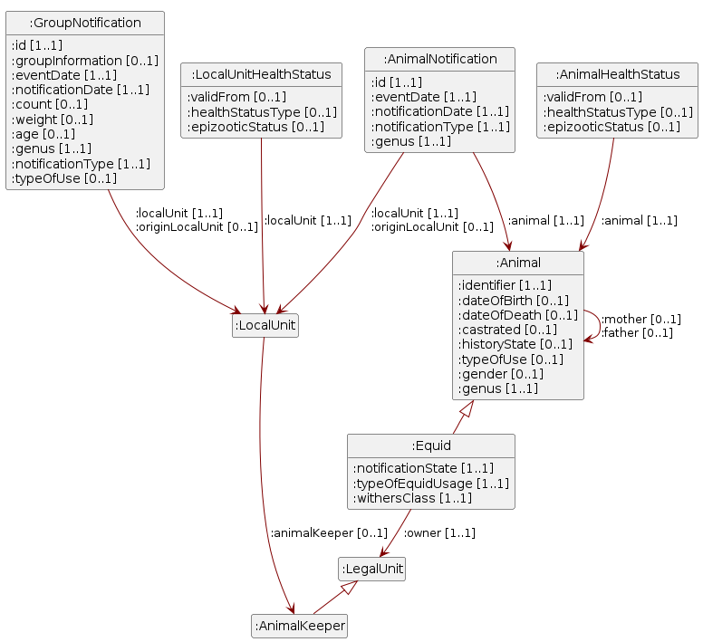

# Document auxiliaire : données sur le trafic des animaux

30 octobre 2026

- [Remarque](#sec-note)
- [1
  Introduction](#sec-introduction)
  - [1.1 Statut](#sec-status)
  - [1.2 Domaine
    d’application](#sec-scope-of-application)
  - [1.3 La notification du
    trafic des animaux en Suisse](#sec-animal-movement-reporting)
  - [1.4
    Renvois](#sec-references)
- [2 Espaces de
  noms](#sec-namespaces)
- [3 Modèle de
  données](#sec-data-model)
  - [3.1 Animal
    individuel](#sec-nodeshape-animalshape)
  - [3.2 Détenteur
    d’animaux](#sec-nodeshape-animalkeepershape)
  - [3.3 Notification d’animal
    individuel](#sec-nodeshape-animalnotificationshape)
  - [3.4 Notification de
    groupe](#sec-nodeshape-groupnotificationshape)
  - [3.5 Unité
    juridique](#sec-nodeshape-legalunitshape)
  - [3.6 Unité
    locale](#sec-nodeshape-localunitshape)
  - [3.7
    Équidé](#sec-nodeshape-equidshape)
  - [3.8 État sanitaire de
    l’animal individuel](#sec-nodeshape-animalhealthstatusshape)
  - [3.9 État sanitaire de
    l’unité locale](#sec-nodeshape-localunithealthstatusshape)
- [4 Domaines de
  valeurs](#sec-code-lists)
  - [4.1 Catégorie de
    taille](#sec-codelist-equidwithersclass)
  - [4.2 Espèce d’animal de
    rente](#sec-codelist-genus)
  - [4.3
    Sexe](#sec-codelist-gender)
  - [4.4 Statut d’annonce de
    l’équidé](#sec-codelist-equidnotificationstate)
  - [4.5 Statut de l’historique
    de l’animal](#sec-codelist-animalhistorystate)
  - [4.6 Type d’utilisation
    (bovins, ovins, caprins)](#sec-codelist-animaltypeofuse)
  - [4.7 Type d’utilisation
    (équidés)](#sec-codelist-equidtypeofusage)
  - [4.8 Type d’état
    sanitaire](#sec-codelist-healthstatustype)
  - [4.9 Type de
    mouvement](#sec-codelist-notificationtype)
  - [4.10 État sanitaire de
    l’animal individuel](#sec-codelist-animalepizooticstatus)
  - [4.11 État sanitaire de
    l’unité locale](#sec-codelist-localunitepizooticstatus)
- [5 Considérations de
  sécurité](#sec-safety-consideration)
- [6 Clause de
  non-responsabilité](#sec-disclaimer)
- [7 Droits
  d’auteur](#sec-copyrights)
- [8 Annexe A -
  Références](#sec-appendix-a)
- [9 Annexe B - Collaboration et
  Vérification](#sec-appendix-b)
- [10 Annexe C - Abréviations et
  glossaire](#sec-appendix-c)
- [11 Annexe D - Correspondance
  avec l’interface de la BDTA](#sec-appendix-d)
- [12 Annexe E - Modifications
  par rapport à la version précédente](#sec-appendix-e)
- [13 Annexe F - Table des
  illustrations](#sec-appendix-f)
- [14 Annexe G - Liste des
  tableaux](#sec-appendix-g)

# Remarque

Dans le présent document, les désignations de personnes sont formulées
de manière épicène (neutre du point de vue du genre). Le guide de la
Chancellerie fédérale sert de base. Selon la situation, on utilise des
formulations paires (citoyennes et citoyens), des formes abstraites
(personne assurée), des formes neutres ou des périphrases sans référence
à la personne. L’usage du masculin générique n’est pas autorisé. Les
formes complètes sont employées dans le texte continu, c’est-à-dire dans
les textes composés de phrases rédigées. Dans les passages de texte
raccourcis, notamment dans les tableaux, des formes abrégées peuvent
être utilisées. La forme abrégée s’utilise alors avec une barre oblique,
mais sans trait d’omission (rapporteur/euse). L’astérisque de genre et
les typographies similaires ne sont pas utilisés.

# Introduction

## Statut

En cours : L’utilisation n’est autorisée qu’au sein du groupe spécialisé
et du comité d’experts.

## Domaine d’application

Le présent document décrit sémantiquement les données de la banque de
données sur le trafic des animaux (BDTA), afin de permettre également
aux spécialistes sans connaissances informatiques approfondies de mieux
comprendre ces données.

## La notification du trafic des animaux en Suisse

Dans les années 1990, l’agriculture et l’industrie alimentaire suisses
ont été fortement mises à l’épreuve par l’épizootie «ESB». Lorsque la
transmissibilité de la maladie de l’animal à l’être humain s’est
confirmée en 1996, cela a provoqué une grande incertitude. Les attentes
en matière de sécurité des denrées alimentaires d’origine animale ont
augmenté en conséquence, de même que la conscience de l’importance du
contrôle des denrées alimentaires. L’approche «de l’étable à la table»
s’est imposée. La surveillance basée sur les risques, la traçabilité
sans faille des animaux de rente, le contrôle du trafic des animaux,
l’obligation de déclarer la provenance ainsi que les contrôles de
qualité tout au long de la chaîne de production et de transformation
constituent depuis lors la base d’un niveau élevé de sécurité
alimentaire[^1].

L’expérience de l’ESB a conduit en 1999 à la création d’une banque de
données nationale sur le trafic des animaux (BDTA). L’article 7a ainsi
que les articles 13 à 15 de la loi sur les épizooties[^2] et le titre 2,
sections 1, 1a et 2a de l’ordonnance sur les épizooties[^3] énoncent les
dispositions légales fondamentales relatives à l’identification/au
marquage et à l’enregistrement des animaux de rente ainsi qu’aux
obligations d’annonce correspondantes. Elles s’alignent sur la
législation européenne en la matière[^4] (règlement (UE) 2016/429 sur
les maladies animales transmissibles; règlement délégué (UE) 2019/2035
concernant les établissements détenant des animaux terrestres et les
couvoirs ainsi que la traçabilité).

Si seuls les bovins étaient soumis à l’obligation d’annonce à partir de
1999, les porcs et les équidés ont suivi dès 2011, même si les porcs ne
font aujourd’hui encore pas l’objet d’annonces par animal individuel. À
partir de 2014, respectivement de 2020, l’obligation d’annonce à la BDTA
s’est également appliquée aux petits ruminants (moutons et chèvres). Au
début, en 2014, elle ne concernait que les abattoirs. Depuis 2014, il
existe également une obligation d’annonce pour la volaille[^5]. Depuis
janvier 2020, les détenteurs de petits ruminants sont eux aussi intégrés
dans le système d’annonce des animaux individuels.[^6] L’identification
et le marquage des animaux à onglons au moyen de marques auriculaires,
l’enregistrement individuel des bovins, des moutons et des chèvres dans
la BDTA, ainsi que l’annonce des entrées, des sorties (l’animal quitte
vivant une unité d’élevage), des naissances, des importations, des
exportations, des abattages, des abattages à la ferme et des morts
(l’animal est désannoncé comme n’étant plus vivant) sont obligatoires
pour tous les détenteurs d’animaux en Suisse[^7]. Les annonces sont en
outre soumises à des délais légaux[^8].

La BDTA fait partie d’un paysage systémique regroupant l’agriculture,
les affaires vétérinaires et la sécurité alimentaire. Le portail
Agate[^9] en constitue la porte d’entrée centrale, avec au cœur le
système d’information sur la politique agricole AGIS[^10].

<!-- Abbildung «Systemlandschaft und Datenflüsse» wird nachgeliefert. -->

L’ordonnance sur Identitas SA et la banque de données sur le trafic des
animaux[^11] (OId-BDTA) précise les contenus relatifs au trafic des
animaux, les tâches d’Identitas SA ainsi que les droits d’accès aux
données. L’importance de l’identification/du marquage des animaux de
rente dépasse largement la problématique des épizooties et a donc
également trouvé sa place dans la législation agricole[^12] (loi sur
l’agriculture LAgr, art. 165g, 177 et 185) et dans diverses ordonnances
associées. Les données issues du trafic des animaux sont devenues un
élément indispensable de la mise en œuvre des mesures de politique
agricole, par exemple les paiements directs liés aux animaux[^13], la
détermination des flux d’éléments nutritifs ou le monitoring
agroenvironnemental[^14]. Ces données servent en outre de base au relevé
des structures de l’agriculture suisse[^15] et, plus généralement, à la
statistique agricole[^16].

Le système d’annonce du trafic des animaux s’est rapidement imposé tout
au long de la chaîne de valeur alimentaire. Les programmes assortis de
promesses en matière de bien-être animal, de traçabilité et de
provenance s’y appuient[^17]. La diversité des informations sur les
animaux issues du système d’annonce du trafic des animaux se reflète
également dans les jeux de données publiquement disponibles de la
plateforme Open Data Tierstatistik[^18].

La description technique des interfaces figurant dans le présent
document se fonde sur la description technique de service AnimalTracing
v1.32 ainsi que sur la spécification openAPI v. x.xx.

## Renvois

Interfaces: AnimalTracing API, description technique de service
AnimalTracing

# Espaces de noms

Le <a href="#tbl-namespaces" class="quarto-xref">Table 1</a> énumère les
préfixes et les espaces de noms utilisés dans ce document. Un préfixe
tient lieu d’une IRI d’espace de noms, le début commun des IRI d’un
vocabulaire. La spécification Turtle décrit comment ces [*prefixed
names*](https://www.w3.org/TR/turtle/#prefixed-name) sont résolus
\[Turtle\].

Table 1: Espaces de noms utilisés dans eCH-0309 – Document auxiliaire :
données sur le trafic des animaux.

| Préfixe   | Espace de noms                                       |
|:----------|:-----------------------------------------------------|
| :         | https://agriculture.ld.admin.ch/eCH-0309/1/          |
| codelist: | https://agriculture.ld.admin.ch/eCH-0309/1/codelist/ |
| schema:   | http://schema.org/                                   |
| xsd:      | http://www.w3.org/2001/XMLSchema#                    |

# Modèle de données

Figure 1: Diagramme UML du modèle de données eCH-0309.

La <a href="#fig-uml" class="quarto-xref">Figure 1</a> présente les
classes du modèle de données et leurs relations. Chaque rectangle est
une classe, les lignes qu’il contient sont ses attributs; les crochets
indiquent le nombre de valeurs admises, du minimum au maximum — `[1..1]`
signifie exactement une valeur, `[0..1]` au plus une. Une flèche mène à
la classe vers laquelle le renvoi est fait et porte le nom de la
relation; plusieurs relations entre les deux mêmes classes se partagent
une flèche. La ligne munie d’un triangle relie une classe à sa classe
supérieure, vers laquelle le triangle pointe: un équidé est un animal
individuel et possède, outre les attributs représentés, tous les
attributs de l’animal individuel, qui ne sont pas répétés dans le
diagramme. Les attributs assortis d’un domaine de valeurs sont
représentés comme tous les autres; les valeurs admises figurent au
<a href="#sec-code-lists" class="quarto-xref">Section 4</a>. Le
diagramme n’indique ni les types de données ni les descriptions:
celles-ci suivent dans les sections consacrées aux différentes classes.

## Animal individuel

Un animal de rente identifié individuellement. Dans la banque de données
sur le trafic des animaux, les animaux des catégories bovins, ovins,
caprins et équidés sont enregistrés comme animaux individuels ; ils sont
identifiés de manière univoque par leur numéro de marque auriculaire, ou
par l’UELN pour les équidés. Aucun animal individuel n’est tenu pour les
porcs et la volaille, mais uniquement des notifications de groupe.

### Aperçu

Shape  
[:AnimalShape](https://agriculture.ld.admin.ch/eCH-0309/1/AnimalShape)

Classe cible  
[:Animal](https://agriculture.ld.admin.ch/eCH-0309/1/Animal)

### Propriétés

<table style="width:99%;">
<colgroup>
<col style="width: 50%" />
<col style="width: 39%" />
<col style="width: 9%" />
</colgroup>
<thead>
<tr>
<th style="text-align: left;">Description</th>
<th style="text-align: left;">Détails</th>
<th style="text-align: right;">Cardinalité</th>
</tr>
</thead>
<tbody>
<tr>
<td style="text-align: left;"><strong>Mère</strong> (<a
href="https://agriculture.ld.admin.ch/eCH-0309/1/mother">:mother</a>):
Un animal individuel a au plus une mère.</td>
<td style="text-align: left;"><ul>
<li>Type: <a href="#sec-nodeshape-animalshape">Animal
individuel</a></li>
</ul></td>
<td style="text-align: right;">0..1</td>
</tr>
<tr>
<td style="text-align: left;"><strong>Père</strong> (<a
href="https://agriculture.ld.admin.ch/eCH-0309/1/father">:father</a>):
Un animal individuel a au plus un père.</td>
<td style="text-align: left;"><ul>
<li>Type: <a href="#sec-nodeshape-animalshape">Animal
individuel</a></li>
</ul></td>
<td style="text-align: right;">0..1</td>
</tr>
<tr>
<td style="text-align: left;"><strong>Identifiant</strong> (<a
href="https://agriculture.ld.admin.ch/eCH-0309/1/identifier">:identifier</a>):
Numéro de marque auriculaire, UELN pour les équidés</td>
<td style="text-align: left;"><ul>
<li>Type: Chaîne de caractères (<a
href="http://www.w3.org/2001/XMLSchema#string">xsd:string</a>)</li>
<li>Longueur: ≤ 15 caractères</li>
</ul></td>
<td style="text-align: right;">1..1</td>
</tr>
<tr>
<td style="text-align: left;"><strong>Espèce d’animal de rente</strong>
(<a
href="https://agriculture.ld.admin.ch/eCH-0309/1/genus">:genus</a>)</td>
<td style="text-align: left;"><ul>
<li>Type: <a
href="http://schema.org/CategoryCode">schema:CategoryCode</a>, voir la
liste de codes <a href="#sec-codelist-genus">Espèce d’animal de
rente</a></li>
</ul></td>
<td style="text-align: right;">1..1</td>
</tr>
<tr>
<td style="text-align: left;"><strong>Sexe</strong> (<a
href="https://agriculture.ld.admin.ch/eCH-0309/1/gender">:gender</a>)</td>
<td style="text-align: left;"><ul>
<li>Type: <a
href="http://schema.org/CategoryCode">schema:CategoryCode</a>, voir la
liste de codes <a href="#sec-codelist-gender">Sexe</a></li>
</ul></td>
<td style="text-align: right;">0..1</td>
</tr>
<tr>
<td style="text-align: left;"><strong>Date de naissance</strong> (<a
href="https://agriculture.ld.admin.ch/eCH-0309/1/dateOfBirth">:dateOfBirth</a>)</td>
<td style="text-align: left;"><ul>
<li>Type: Date (<a
href="http://www.w3.org/2001/XMLSchema#date">xsd:date</a>)</li>
</ul></td>
<td style="text-align: right;">0..1</td>
</tr>
<tr>
<td style="text-align: left;"><strong>Date de mort</strong> (<a
href="https://agriculture.ld.admin.ch/eCH-0309/1/dateOfDeath">:dateOfDeath</a>)</td>
<td style="text-align: left;"><ul>
<li>Type: Date (<a
href="http://www.w3.org/2001/XMLSchema#date">xsd:date</a>)</li>
</ul></td>
<td style="text-align: right;">0..1</td>
</tr>
<tr>
<td style="text-align: left;"><strong>Statut de l’historique de
l’animal</strong> (<a
href="https://agriculture.ld.admin.ch/eCH-0309/1/historyState">:historyState</a>):
Statut de l’historique de l’animal à la date de la requête. Non
pertinent pour les équidés ; l’obligation ne vaut donc que pour les
autres animaux individuels.</td>
<td style="text-align: left;"><ul>
<li>Type: <a
href="http://schema.org/CategoryCode">schema:CategoryCode</a>, voir la
liste de codes <a href="#sec-codelist-animalhistorystate">Statut de
l’historique de l’animal</a></li>
</ul></td>
<td style="text-align: right;">0..1</td>
</tr>
<tr>
<td style="text-align: left;"><strong>Type d’utilisation</strong> (<a
href="https://agriculture.ld.admin.ch/eCH-0309/1/typeOfUse">:typeOfUse</a>)</td>
<td style="text-align: left;"><ul>
<li>Type: <a
href="http://schema.org/CategoryCode">schema:CategoryCode</a>, voir la
liste de codes <a href="#sec-codelist-animaltypeofuse">Type
d’utilisation (bovins, ovins, caprins)</a></li>
</ul></td>
<td style="text-align: right;">0..1</td>
</tr>
<tr>
<td style="text-align: left;"><strong>Castré</strong> (<a
href="https://agriculture.ld.admin.ch/eCH-0309/1/castrated">:castrated</a>):
Indique si l’animal est castré. S’applique également aux équidés.</td>
<td style="text-align: left;"><ul>
<li>Type: Booléen (<a
href="http://www.w3.org/2001/XMLSchema#boolean">xsd:boolean</a>)</li>
</ul></td>
<td style="text-align: right;">0..1</td>
</tr>
</tbody>
</table>

### Règles

Le statut de l’historique de l’animal n’est pas pertinent pour les
équidés. Il est donc obligatoire pour tout animal individuel à
l’exception des équidés.

## Détenteur d’animaux

Un exploitant est une unité juridique au sens de l’eCH-0108 qui assume
le risque économique d’une exploitation (OTerm art. 2). Le détenteur
d’animaux est une forme d’exploitant qui détient des animaux (OTerm art.
11a) ; il lui faut donc une unité locale (unité d’élevage). La
responsabilité des notifications incombe au détenteur d’animaux pour
toutes les catégories d’animaux à l’exception des équidés ; pour les
équidés, elle incombe au propriétaire ou à la propriétaire. Les
attributs sont décrits dans
l’[eCH-0261](https://ech.ch/sites/default/files/imce/eCH-Dossier/eCH-Dossier_PDF_Publikationen/Hauptdokument/STAN_d_DEF_2024-02_07_eCH-0261_V1.0.0_Datenstandard_Agrardaten_Stammdaten.pdf),
chapitres 3.1 et 3.2.

### Aperçu

Shape  
[:AnimalKeeperShape](https://agriculture.ld.admin.ch/eCH-0309/1/AnimalKeeperShape)

Classe cible  
[:AnimalKeeper](https://agriculture.ld.admin.ch/eCH-0309/1/AnimalKeeper)

## Notification d’animal individuel

Un événement concernant un animal individuel. Sont considérées comme
événements les notifications de mouvement, les notifications de données
de base, les modifications d’attributs individuels des données de base
ainsi que les notifications finales. Une notification se rapporte
toujours à l’unité locale où l’événement a eu lieu et peut en outre
indiquer l’unité locale de provenance. Les événements sont annoncés par
les personnes autorisées, avec indication de l’unité d’élevage à
laquelle la notification se rapporte ; pour les équidés, ils sont
annoncés par les personnes autorisées du propriétaire d’équidés
responsable.

### Aperçu

Shape  
[:AnimalNotificationShape](https://agriculture.ld.admin.ch/eCH-0309/1/AnimalNotificationShape)

Classe cible  
[:AnimalNotification](https://agriculture.ld.admin.ch/eCH-0309/1/AnimalNotification)

### Propriétés

<table style="width:99%;">
<colgroup>
<col style="width: 53%" />
<col style="width: 37%" />
<col style="width: 9%" />
</colgroup>
<thead>
<tr>
<th style="text-align: left;">Description</th>
<th style="text-align: left;">Détails</th>
<th style="text-align: right;">Cardinalité</th>
</tr>
</thead>
<tbody>
<tr>
<td style="text-align: left;"><strong>Identifiant</strong> (<a
href="https://agriculture.ld.admin.ch/eCH-0309/1/animal">:animal</a>):
Une notification d’animal individuel se rapporte à exactement un animal
individuel.</td>
<td style="text-align: left;"><ul>
<li>Type: <a href="#sec-nodeshape-animalshape">Animal
individuel</a></li>
</ul></td>
<td style="text-align: right;">1..1</td>
</tr>
<tr>
<td style="text-align: left;"><strong>Unité locale</strong> (<a
href="https://agriculture.ld.admin.ch/eCH-0309/1/localUnit">:localUnit</a>):
Numéro REE de l’unité locale à laquelle se rapporte la notification</td>
<td style="text-align: left;"><ul>
<li>Type: <a href="#sec-nodeshape-localunitshape">Unité locale</a></li>
</ul></td>
<td style="text-align: right;">1..1</td>
</tr>
<tr>
<td style="text-align: left;"><strong>Provenance</strong> (<a
href="https://agriculture.ld.admin.ch/eCH-0309/1/originLocalUnit">:originLocalUnit</a>):
Numéro REE de l’unité locale d’où provient l’animal</td>
<td style="text-align: left;"><ul>
<li>Type: <a href="#sec-nodeshape-localunitshape">Unité locale</a></li>
</ul></td>
<td style="text-align: right;">0..1</td>
</tr>
<tr>
<td style="text-align: left;"><strong>ID</strong> (<a
href="https://agriculture.ld.admin.ch/eCH-0309/1/id">:id</a>):
Identifiant univoque du mouvement, attribué par le système.</td>
<td style="text-align: left;"><ul>
<li>Type: Chaîne de caractères (<a
href="http://www.w3.org/2001/XMLSchema#string">xsd:string</a>)</li>
</ul></td>
<td style="text-align: right;">1..1</td>
</tr>
<tr>
<td style="text-align: left;"><strong>Espèce d’animal de rente</strong>
(<a
href="https://agriculture.ld.admin.ch/eCH-0309/1/genus">:genus</a>)</td>
<td style="text-align: left;"><ul>
<li>Type: <a
href="http://schema.org/CategoryCode">schema:CategoryCode</a>, voir la
liste de codes <a href="#sec-codelist-genus">Espèce d’animal de
rente</a></li>
</ul></td>
<td style="text-align: right;">1..1</td>
</tr>
<tr>
<td style="text-align: left;"><strong>Type de mouvement</strong> (<a
href="https://agriculture.ld.admin.ch/eCH-0309/1/notificationType">:notificationType</a>)</td>
<td style="text-align: left;"><ul>
<li>Type: <a
href="http://schema.org/CategoryCode">schema:CategoryCode</a>, voir la
liste de codes <a href="#sec-codelist-notificationtype">Type de
mouvement</a></li>
</ul></td>
<td style="text-align: right;">1..1</td>
</tr>
<tr>
<td style="text-align: left;"><strong>Date de l’événement</strong> (<a
href="https://agriculture.ld.admin.ch/eCH-0309/1/eventDate">:eventDate</a>):
Date à laquelle l’événement a eu lieu</td>
<td style="text-align: left;"><ul>
<li>Type: Date (<a
href="http://www.w3.org/2001/XMLSchema#date">xsd:date</a>)</li>
</ul></td>
<td style="text-align: right;">1..1</td>
</tr>
<tr>
<td style="text-align: left;"><strong>Date d’annonce</strong> (<a
href="https://agriculture.ld.admin.ch/eCH-0309/1/notificationDate">:notificationDate</a>):
Date à laquelle l’événement a été annoncé</td>
<td style="text-align: left;"><ul>
<li>Type: Date (<a
href="http://www.w3.org/2001/XMLSchema#date">xsd:date</a>)</li>
</ul></td>
<td style="text-align: right;">1..1</td>
</tr>
</tbody>
</table>

## Notification de groupe

Un événement concernant un groupe d’animaux qui ne peuvent pas être
identifiés individuellement. Les notifications de groupe sont
enregistrées pour les animaux des catégories porcs et volaille ; les
individus d’un tel groupe ne sont donc pas connus. Les événements sont
annoncés par les personnes physiques de l’unité juridique responsable,
le détenteur d’animaux. Ils comprennent les annonces de mise en place
pour la volaille, les annonces de mouvement pour les porcs ainsi que les
annonces d’abattage de porcs (en têtes) et de groupes de volaille (en
kg).

### Aperçu

Shape  
[:GroupNotificationShape](https://agriculture.ld.admin.ch/eCH-0309/1/GroupNotificationShape)

Classe cible  
[:GroupNotification](https://agriculture.ld.admin.ch/eCH-0309/1/GroupNotification)

### Propriétés

<table style="width:99%;">
<colgroup>
<col style="width: 52%" />
<col style="width: 37%" />
<col style="width: 9%" />
</colgroup>
<thead>
<tr>
<th style="text-align: left;">Description</th>
<th style="text-align: left;">Détails</th>
<th style="text-align: right;">Cardinalité</th>
</tr>
</thead>
<tbody>
<tr>
<td style="text-align: left;"><strong>Unité locale</strong> (<a
href="https://agriculture.ld.admin.ch/eCH-0309/1/localUnit">:localUnit</a>):
Numéro REE de l’unité locale</td>
<td style="text-align: left;"><ul>
<li>Type: <a href="#sec-nodeshape-localunitshape">Unité locale</a></li>
</ul></td>
<td style="text-align: right;">1..1</td>
</tr>
<tr>
<td style="text-align: left;"><strong>Provenance</strong> (<a
href="https://agriculture.ld.admin.ch/eCH-0309/1/originLocalUnit">:originLocalUnit</a>):
Numéro REE de l’unité locale d’où provient l’animal</td>
<td style="text-align: left;"><ul>
<li>Type: <a href="#sec-nodeshape-localunitshape">Unité locale</a></li>
</ul></td>
<td style="text-align: right;">0..1</td>
</tr>
<tr>
<td style="text-align: left;"><strong>ID</strong> (<a
href="https://agriculture.ld.admin.ch/eCH-0309/1/id">:id</a>):
Identifiant univoque du mouvement, attribué par le système.</td>
<td style="text-align: left;"><ul>
<li>Type: Chaîne de caractères (<a
href="http://www.w3.org/2001/XMLSchema#string">xsd:string</a>)</li>
</ul></td>
<td style="text-align: right;">1..1</td>
</tr>
<tr>
<td style="text-align: left;"><strong>Espèce d’animal de rente</strong>
(<a
href="https://agriculture.ld.admin.ch/eCH-0309/1/genus">:genus</a>)</td>
<td style="text-align: left;"><ul>
<li>Type: <a
href="http://schema.org/CategoryCode">schema:CategoryCode</a>, voir la
liste de codes <a href="#sec-codelist-genus">Espèce d’animal de
rente</a></li>
</ul></td>
<td style="text-align: right;">1..1</td>
</tr>
<tr>
<td style="text-align: left;"><strong>Information de groupe</strong> (<a
href="https://agriculture.ld.admin.ch/eCH-0309/1/groupInformation">:groupInformation</a>):
Une information de groupe doit être indiquée pour les annonces de mise
en place de volaille</td>
<td style="text-align: left;"><ul>
<li>Type: Chaîne de caractères (<a
href="http://www.w3.org/2001/XMLSchema#string">xsd:string</a>)</li>
</ul></td>
<td style="text-align: right;">0..1</td>
</tr>
<tr>
<td style="text-align: left;"><strong>Type de mouvement</strong> (<a
href="https://agriculture.ld.admin.ch/eCH-0309/1/notificationType">:notificationType</a>)</td>
<td style="text-align: left;"><ul>
<li>Type: <a
href="http://schema.org/CategoryCode">schema:CategoryCode</a>, voir la
liste de codes <a href="#sec-codelist-notificationtype">Type de
mouvement</a></li>
</ul></td>
<td style="text-align: right;">1..1</td>
</tr>
<tr>
<td style="text-align: left;"><strong>Date de l’événement</strong> (<a
href="https://agriculture.ld.admin.ch/eCH-0309/1/eventDate">:eventDate</a>):
Date à laquelle l’événement a eu lieu</td>
<td style="text-align: left;"><ul>
<li>Type: Date (<a
href="http://www.w3.org/2001/XMLSchema#date">xsd:date</a>)</li>
</ul></td>
<td style="text-align: right;">1..1</td>
</tr>
<tr>
<td style="text-align: left;"><strong>Date d’annonce</strong> (<a
href="https://agriculture.ld.admin.ch/eCH-0309/1/notificationDate">:notificationDate</a>):
Date à laquelle l’événement a été annoncé</td>
<td style="text-align: left;"><ul>
<li>Type: Date (<a
href="http://www.w3.org/2001/XMLSchema#date">xsd:date</a>)</li>
</ul></td>
<td style="text-align: right;">1..1</td>
</tr>
<tr>
<td style="text-align: left;"><strong>Nombre</strong> (<a
href="https://agriculture.ld.admin.ch/eCH-0309/1/count">:count</a>):
Nombre d’animaux déplacés lors d’un mouvement (porcs/volaille)</td>
<td style="text-align: left;"><ul>
<li>Type: Nombre entier (<a
href="http://www.w3.org/2001/XMLSchema#integer">xsd:integer</a>)</li>
</ul></td>
<td style="text-align: right;">0..1</td>
</tr>
<tr>
<td style="text-align: left;"><strong>Poids</strong> (<a
href="https://agriculture.ld.admin.ch/eCH-0309/1/weight">:weight</a>):
Poids total en kg du groupe d’animaux pour les annonces d’abattage de
volaille</td>
<td style="text-align: left;"><ul>
<li>Type: Nombre entier (<a
href="http://www.w3.org/2001/XMLSchema#integer">xsd:integer</a>)</li>
</ul></td>
<td style="text-align: right;">0..1</td>
</tr>
<tr>
<td style="text-align: left;"><strong>Type d’utilisation</strong> (<a
href="https://agriculture.ld.admin.ch/eCH-0309/1/typeOfUse">:typeOfUse</a>):
Type d’utilisation du groupe d’animaux (pour les animaux individuels il
figure sur la classe «Einzeltier»)</td>
<td style="text-align: left;"><ul>
<li>Type: <a
href="http://schema.org/CategoryCode">schema:CategoryCode</a>, voir la
liste de codes <a href="#sec-codelist-animaltypeofuse">Type
d’utilisation (bovins, ovins, caprins)</a></li>
</ul></td>
<td style="text-align: right;">0..1</td>
</tr>
<tr>
<td style="text-align: left;"><strong>Âge</strong> (<a
href="https://agriculture.ld.admin.ch/eCH-0309/1/age">:age</a>): Pour
les annonces de mise en place de volaille, l’âge doit être indiqué en
semaines</td>
<td style="text-align: left;"><ul>
<li>Type: Nombre entier (<a
href="http://www.w3.org/2001/XMLSchema#integer">xsd:integer</a>)</li>
</ul></td>
<td style="text-align: right;">0..1</td>
</tr>
</tbody>
</table>

## Unité juridique

L’unité juridique au sens de l’eCH-0108 est une personne morale (p. ex.
société anonyme, Sàrl), une société de personnes (p. ex. société en nom
collectif) ou une personne physique exerçant une activité indépendante
qui est soumise à la loi fédérale sur le numéro d’identification des
entreprises (LIDE) et qui est inscrite au registre IDE. Elle identifie
par exemple le sujet fiscal pour les autorités fiscales ou la personne
assujettie aux cotisations d’assurances sociales. L’unité juridique est
identifiée par son IDE. Ce n’est que lorsque l’entreprise est une
«entreprise individuelle» que l’exploitant est en même temps une
personne physique. Le système maître de ces données est le registre IDE
de l’OFS ; le système d’information agricole obtient les données de ce
registre via une interface. Le détenteur d’animaux et le propriétaire
d’équidés sont les deux formes d’unité juridique qui apparaissent dans
le présent document. Les attributs sont décrits dans
l’[eCH-0261](https://ech.ch/sites/default/files/imce/eCH-Dossier/eCH-Dossier_PDF_Publikationen/Hauptdokument/STAN_d_DEF_2024-02_07_eCH-0261_V1.0.0_Datenstandard_Agrardaten_Stammdaten.pdf),
chapitres 3.1 et 3.2, ainsi que dans
l’[eCH-0108](https://ech.ch/sites/default/files/imce/eCH-Dossier/eCH-Dossier_PDF_Publikationen/Hauptdokument/STAN_d_DEF_2023-12-21_eCH-0108_V6.0.0_Unternehmensstammdaten%20Unternehmensregister.pdf),
chapitre 3.1.

### Aperçu

Shape  
[:LegalUnitShape](https://agriculture.ld.admin.ch/eCH-0309/1/LegalUnitShape)

Classe cible  
[:LegalUnit](https://agriculture.ld.admin.ch/eCH-0309/1/LegalUnit)

## Unité locale

Une unité locale au sens de l’eCH-0108 est une installation située en un
lieu déterminé où s’exerce une activité économique. Une unité locale
possède un numéro REE et est toujours rattachée à une unité juridique
(ou entreprise). L’unité locale est identifiée par son numéro REE. Une
unité locale peut se composer d’un ou de plusieurs bâtiments. L’EGID
attribué au numéro REE se rapporte au «centre» de l’unité locale,
respectivement à son bâtiment principal. Dans la BDTA, les unités
locales sont appelées «unités d’élevage» et sont en outre identifiées
par leur numéro BDTA. Cette définition est tirée de
l’[eCH-0108](https://ech.ch/sites/default/files/imce/eCH-Dossier/eCH-Dossier_PDF_Publikationen/Hauptdokument/STAN_d_DEF_2023-12-21_eCH-0108_V6.0.0_Unternehmensstammdaten%20Unternehmensregister.pdf),
chapitre 1.5 ; les compléments spécifiques à l’agriculture sont décrits
dans
l’[eCH-0261](https://ech.ch/sites/default/files/imce/eCH-Dossier/eCH-Dossier_PDF_Publikationen/Hauptdokument/STAN_d_DEF_2024-02_07_eCH-0261_V1.0.0_Datenstandard_Agrardaten_Stammdaten.pdf),
chapitres 3.3 et 3.4.

### Aperçu

Shape  
[:LocalUnitShape](https://agriculture.ld.admin.ch/eCH-0309/1/LocalUnitShape)

Classe cible  
[:LocalUnit](https://agriculture.ld.admin.ch/eCH-0309/1/LocalUnit)

### Propriétés

<table style="width:99%;">
<colgroup>
<col style="width: 54%" />
<col style="width: 34%" />
<col style="width: 10%" />
</colgroup>
<thead>
<tr>
<th style="text-align: left;">Description</th>
<th style="text-align: left;">Détails</th>
<th style="text-align: right;">Cardinalité</th>
</tr>
</thead>
<tbody>
<tr>
<td style="text-align: left;"><strong>Détenteur d’animaux</strong> (<a
href="https://agriculture.ld.admin.ch/eCH-0309/1/animalKeeper">:animalKeeper</a>):
Rattachement de l’unité locale au détenteur d’animaux. Selon l’eCH-0108,
chapitre 1.5, une unité locale est toujours rattachée à une unité
juridique (ou entreprise) ; les données de base de l’unité locale
comportent à cet effet l’attribut facultatif «mainUid» contenant l’IDE
de l’unité juridique principale. Le détenteur d’animaux n’étant qu’une
forme particulière de l’unité juridique, ce rattachement n’est pas
obligatoire.</td>
<td style="text-align: left;"><ul>
<li>Type: <a href="#sec-nodeshape-animalkeepershape">Détenteur
d’animaux</a></li>
</ul></td>
<td style="text-align: right;">0..1</td>
</tr>
</tbody>
</table>

## Équidé

Sous-classe de la classe animal individuel pour les animaux du genre
équidé (cheval, mulet, bardot, âne). Tous les attributs de la classe
animal individuel s’appliquent également aux équidés ; cette classe ne
décrit que les informations supplémentaires propres aux équidés. Pour
les équidés, la responsabilité des notifications incombe au propriétaire
et non au détenteur d’animaux. Un propriétaire est l’unité juridique qui
détient des équidés en propriété ; le terme n’est utilisé que pour les
propriétaires d’équidés.

### Aperçu

Shape  
[:EquidShape](https://agriculture.ld.admin.ch/eCH-0309/1/EquidShape)

Classe cible  
[:Equid](https://agriculture.ld.admin.ch/eCH-0309/1/Equid)

### Propriétés

<table style="width:99%;">
<colgroup>
<col style="width: 53%" />
<col style="width: 36%" />
<col style="width: 9%" />
</colgroup>
<thead>
<tr>
<th style="text-align: left;">Description</th>
<th style="text-align: left;">Détails</th>
<th style="text-align: right;">Cardinalité</th>
</tr>
</thead>
<tbody>
<tr>
<td style="text-align: left;"><strong>Propriétaire</strong> (<a
href="https://agriculture.ld.admin.ch/eCH-0309/1/owner">:owner</a>):
L’unité juridique qui détient l’équidé en propriété. Pour les équidés,
la responsabilité des notifications incombe au propriétaire et non au
détenteur d’animaux.</td>
<td style="text-align: left;"><ul>
<li>Type: <a href="#sec-nodeshape-legalunitshape">Unité
juridique</a></li>
</ul></td>
<td style="text-align: right;">1..1</td>
</tr>
<tr>
<td style="text-align: left;"><strong>Catégorie de taille</strong> (<a
href="https://agriculture.ld.admin.ch/eCH-0309/1/withersClass">:withersClass</a>)</td>
<td style="text-align: left;"><ul>
<li>Type: <a
href="http://schema.org/CategoryCode">schema:CategoryCode</a>, voir la
liste de codes <a href="#sec-codelist-equidwithersclass">Catégorie de
taille</a></li>
</ul></td>
<td style="text-align: right;">1..1</td>
</tr>
<tr>
<td style="text-align: left;"><strong>Statut d’annonce</strong> (<a
href="https://agriculture.ld.admin.ch/eCH-0309/1/notificationState">:notificationState</a>):
Les équidés portent un statut d’annonce propre au lieu du statut de
l’historique de l’animal.</td>
<td style="text-align: left;"><ul>
<li>Type: <a
href="http://schema.org/CategoryCode">schema:CategoryCode</a>, voir la
liste de codes <a href="#sec-codelist-equidnotificationstate">Statut
d’annonce de l’équidé</a></li>
</ul></td>
<td style="text-align: right;">1..1</td>
</tr>
<tr>
<td style="text-align: left;"><strong>Type d’utilisation</strong> (<a
href="https://agriculture.ld.admin.ch/eCH-0309/1/typeOfEquidUsage">:typeOfEquidUsage</a>):
Les équidés utilisent un domaine de valeurs propre: animal de compagnie
ou animal de rente.</td>
<td style="text-align: left;"><ul>
<li>Type: <a
href="http://schema.org/CategoryCode">schema:CategoryCode</a>, voir la
liste de codes <a href="#sec-codelist-equidtypeofusage">Type
d’utilisation (équidés)</a></li>
</ul></td>
<td style="text-align: right;">1..1</td>
</tr>
<tr>
<td style="text-align: left;"><strong>Père</strong> (<a
href="https://agriculture.ld.admin.ch/eCH-0309/1/father">:father</a>):
Les équidés n’ont pas de père ; seules la mère et la mère génétique sont
enregistrées.</td>
<td style="text-align: left;"></td>
<td style="text-align: right;">0..0</td>
</tr>
<tr>
<td style="text-align: left;"><strong>Statut de l’historique de
l’animal</strong> (<a
href="https://agriculture.ld.admin.ch/eCH-0309/1/historyState">:historyState</a>):
Non pertinent pour les équidés ; le statut d’annonce prend sa
place.</td>
<td style="text-align: left;"></td>
<td style="text-align: right;">0..0</td>
</tr>
<tr>
<td style="text-align: left;"><strong>Type d’utilisation (animaux de
rente)</strong> (<a
href="https://agriculture.ld.admin.ch/eCH-0309/1/typeOfUse">:typeOfUse</a>):
Ne s’applique pas aux équidés; le type d’utilisation propre aux équidés
prend sa place.</td>
<td style="text-align: left;"></td>
<td style="text-align: right;">0..0</td>
</tr>
</tbody>
</table>

## État sanitaire de l’animal individuel

Une information épizootique enregistrée sur un animal individuel. Outre
le statut épizootique individuel, les vaccinations pertinentes sont
également enregistrées.

### Aperçu

Shape  
[:AnimalHealthStatusShape](https://agriculture.ld.admin.ch/eCH-0309/1/AnimalHealthStatusShape)

Classe cible  
[:AnimalHealthStatus](https://agriculture.ld.admin.ch/eCH-0309/1/AnimalHealthStatus)

### Propriétés

<table style="width:99%;">
<colgroup>
<col style="width: 53%" />
<col style="width: 36%" />
<col style="width: 9%" />
</colgroup>
<thead>
<tr>
<th style="text-align: left;">Description</th>
<th style="text-align: left;">Détails</th>
<th style="text-align: right;">Cardinalité</th>
</tr>
</thead>
<tbody>
<tr>
<td style="text-align: left;"><strong>ID de l’animal</strong> (<a
href="https://agriculture.ld.admin.ch/eCH-0309/1/animal">:animal</a>):
Un état sanitaire de l’animal individuel se rapporte à exactement un
animal individuel.</td>
<td style="text-align: left;"><ul>
<li>Type: <a href="#sec-nodeshape-animalshape">Animal
individuel</a></li>
</ul></td>
<td style="text-align: right;">1..1</td>
</tr>
<tr>
<td style="text-align: left;"><strong>Type</strong> (<a
href="https://agriculture.ld.admin.ch/eCH-0309/1/healthStatusType">:healthStatusType</a>):
p. ex. statut épizootique, vaccinal ou de risque</td>
<td style="text-align: left;"><ul>
<li>Type: <a
href="http://schema.org/CategoryCode">schema:CategoryCode</a>, voir la
liste de codes <a href="#sec-codelist-healthstatustype">Type d’état
sanitaire</a></li>
</ul></td>
<td style="text-align: right;">0..1</td>
</tr>
<tr>
<td style="text-align: left;"><strong>Statut</strong> (<a
href="https://agriculture.ld.admin.ch/eCH-0309/1/epizooticStatus">:epizooticStatus</a>)</td>
<td style="text-align: left;"><ul>
<li>Type: <a
href="http://schema.org/CategoryCode">schema:CategoryCode</a>, voir la
liste de codes <a href="#sec-codelist-animalepizooticstatus">État
sanitaire de l’animal individuel</a></li>
</ul></td>
<td style="text-align: right;">0..1</td>
</tr>
<tr>
<td style="text-align: left;"><strong>Date</strong> (<a
href="https://agriculture.ld.admin.ch/eCH-0309/1/validFrom">:validFrom</a>):
Date à partir de laquelle le statut est valable, ou la date de
vaccination</td>
<td style="text-align: left;"><ul>
<li>Type: Date (<a
href="http://www.w3.org/2001/XMLSchema#date">xsd:date</a>)</li>
</ul></td>
<td style="text-align: right;">0..1</td>
</tr>
</tbody>
</table>

## État sanitaire de l’unité locale

Lorsque des épizooties revêtent une importance nationale, il est
essentiel que les détenteurs d’animaux soient informés des interdictions
de déplacement et du statut épizootique, afin de minimiser le risque de
propagation par le trafic des animaux. Une information épizootique
enregistrée sur une unité locale. Outre le statut épizootique d’une
unité locale, les résultats de vaccination, de risque et de laboratoire
peuvent également être représentés.

### Aperçu

Shape  
[:LocalUnitHealthStatusShape](https://agriculture.ld.admin.ch/eCH-0309/1/LocalUnitHealthStatusShape)

Classe cible  
[:LocalUnitHealthStatus](https://agriculture.ld.admin.ch/eCH-0309/1/LocalUnitHealthStatus)

### Propriétés

<table style="width:99%;">
<colgroup>
<col style="width: 53%" />
<col style="width: 36%" />
<col style="width: 9%" />
</colgroup>
<thead>
<tr>
<th style="text-align: left;">Description</th>
<th style="text-align: left;">Détails</th>
<th style="text-align: right;">Cardinalité</th>
</tr>
</thead>
<tbody>
<tr>
<td style="text-align: left;"><strong>Unité locale</strong> (<a
href="https://agriculture.ld.admin.ch/eCH-0309/1/localUnit">:localUnit</a>):
Numéro REE de l’unité locale</td>
<td style="text-align: left;"><ul>
<li>Type: <a href="#sec-nodeshape-localunitshape">Unité locale</a></li>
</ul></td>
<td style="text-align: right;">1..1</td>
</tr>
<tr>
<td style="text-align: left;"><strong>Type</strong> (<a
href="https://agriculture.ld.admin.ch/eCH-0309/1/healthStatusType">:healthStatusType</a>):
p. ex. statut épizootique, vaccinal ou de risque</td>
<td style="text-align: left;"><ul>
<li>Type: <a
href="http://schema.org/CategoryCode">schema:CategoryCode</a>, voir la
liste de codes <a href="#sec-codelist-healthstatustype">Type d’état
sanitaire</a></li>
</ul></td>
<td style="text-align: right;">0..1</td>
</tr>
<tr>
<td style="text-align: left;"><strong>Statut</strong> (<a
href="https://agriculture.ld.admin.ch/eCH-0309/1/epizooticStatus">:epizooticStatus</a>)</td>
<td style="text-align: left;"><ul>
<li>Type: <a
href="http://schema.org/CategoryCode">schema:CategoryCode</a>, voir la
liste de codes <a href="#sec-codelist-localunitepizooticstatus">État
sanitaire de l’unité locale</a></li>
</ul></td>
<td style="text-align: right;">0..1</td>
</tr>
<tr>
<td style="text-align: left;"><strong>Date</strong> (<a
href="https://agriculture.ld.admin.ch/eCH-0309/1/validFrom">:validFrom</a>):
Date à partir de laquelle le statut est valable</td>
<td style="text-align: left;"><ul>
<li>Type: Date (<a
href="http://www.w3.org/2001/XMLSchema#date">xsd:date</a>)</li>
</ul></td>
<td style="text-align: right;">0..1</td>
</tr>
</tbody>
</table>

# Domaines de valeurs

Les domaines de valeurs suivants définissent les valeurs admises pour
les attributs correspondants du modèle de données
(<a href="#sec-data-model" class="quarto-xref">Section 3</a>). Chaque
domaine de valeurs est modélisé comme `schema:CategoryCodeSet` et
chacune de ses valeurs comme `schema:CategoryCode`. La correspondance
entre les codes et les énumérations de l’interface de la BDTA figure à
l’[annexe D](#sec-appendix-d).

## Catégorie de taille

Classification des équidés en deux catégories selon leur hauteur au
garrot.

Table 2: Valeurs de la liste de codes Catégorie de taille.

| Code | Nom | Description |
|:---|:---|:---|
| [`GreaterThan148cm`](https://agriculture.ld.admin.ch/eCH-0309/1/equidwithersclass/GreaterThan148cm) | Hauteur au garrot supérieure à 148 cm | Équidés d’une hauteur au garrot supérieure à 148 cm |
| [`LessOrEqualThan148cm`](https://agriculture.ld.admin.ch/eCH-0309/1/equidwithersclass/LessOrEqualThan148cm) | Hauteur au garrot jusqu’à 148 cm | Équidés d’une hauteur au garrot de 148 cm au plus |

## Espèce d’animal de rente

Espèces d’animaux de rente dont les animaux sont enregistrés dans la
BDTA et dont les mouvements sont annoncés.

Table 3: Valeurs de la liste de codes Espèce d’animal de rente.

| Code | Nom | Description |
|:---|:---|:---|
| [`Camelid`](https://agriculture.ld.admin.ch/eCH-0309/1/genus/Camelid) | Camélidés | Camélidés du Nouveau Monde |
| [`Cattle`](https://agriculture.ld.admin.ch/eCH-0309/1/genus/Cattle) | Bovins | Animaux de l’espèce bovine (*Bos*) et buffles d’Asie (*Bubalus bubalis*) |
| [`Equid`](https://agriculture.ld.admin.ch/eCH-0309/1/genus/Equid) | Équidés | Animaux de l’espèce équine (cheval, mulet, bardot, âne) |
| [`Game`](https://agriculture.ld.admin.ch/eCH-0309/1/genus/Game) | Gibier | Gibier détenu dans des enclos |
| [`Goat`](https://agriculture.ld.admin.ch/eCH-0309/1/genus/Goat) | Caprins | Chèvres domestiques |
| [`Pig`](https://agriculture.ld.admin.ch/eCH-0309/1/genus/Pig) | Porcs | Porcs domestiques |
| [`Poultry`](https://agriculture.ld.admin.ch/eCH-0309/1/genus/Poultry) | Volaille | Volaille domestique, p. ex. poules, dindes, canards et oies |
| [`Sheep`](https://agriculture.ld.admin.ch/eCH-0309/1/genus/Sheep) | Ovins | Moutons domestiques |

## Sexe

Sexe d’un animal individuel.

Table 4: Valeurs de la liste de codes Sexe.

| Code | Nom | Description |
|:---|:---|:---|
| [`Female`](https://agriculture.ld.admin.ch/eCH-0309/1/gender/Female) | Femelle | Animal femelle |
| [`Male`](https://agriculture.ld.admin.ch/eCH-0309/1/gender/Male) | Mâle | Animal mâle |

## Statut d’annonce de l’équidé

État des annonces concernant un équidé : un changement de lieu ou une
reprise de propriété est-il encore en attente.

Table 5: Valeurs de la liste de codes Statut d’annonce de l’équidé.

| Code | Nom | Description |
|:---|:---|:---|
| [`LocationChangeAndAcquisitionPending`](https://agriculture.ld.admin.ch/eCH-0309/1/equidnotificationstate/LocationChangeAndAcquisitionPending) | Changement de lieu et reprise de propriété en attente | Les annonces d’un changement de lieu et d’une reprise de propriété ne sont pas encore terminées |
| [`LocationChangePending`](https://agriculture.ld.admin.ch/eCH-0309/1/equidnotificationstate/LocationChangePending) | Changement de lieu en attente | L’annonce d’un changement de lieu n’est pas encore terminée |
| [`Ok`](https://agriculture.ld.admin.ch/eCH-0309/1/equidnotificationstate/Ok) | OK | Aucune annonce n’est en attente pour l’équidé |
| [`OwnershipAcquisitionPending`](https://agriculture.ld.admin.ch/eCH-0309/1/equidnotificationstate/OwnershipAcquisitionPending) | Reprise de propriété en attente | L’annonce d’une reprise de propriété n’est pas encore terminée |

## Statut de l’historique de l’animal

Statut de l’historique d’un animal individuel à la date de la requête.
Non pertinent pour les équidés.

Table 6: Valeurs de la liste de codes Statut de l’historique de
l’animal.

| Code | Nom | Description |
|:---|:---|:---|
| [`Lost`](https://agriculture.ld.admin.ch/eCH-0309/1/animalhistorystate/Lost) | Disparu | On ignore où se trouve l’animal |
| [`NotDefined`](https://agriculture.ld.admin.ch/eCH-0309/1/animalhistorystate/NotDefined) | Non défini | Aucun statut n’est défini pour l’historique de l’animal |
| [`NotOk`](https://agriculture.ld.admin.ch/eCH-0309/1/animalhistorystate/NotOk) | Erroné | L’historique de l’animal contient des erreurs ou des lacunes |
| [`Ok`](https://agriculture.ld.admin.ch/eCH-0309/1/animalhistorystate/Ok) | OK | L’historique de l’animal est complet et correct |
| [`TemporaryOk`](https://agriculture.ld.admin.ch/eCH-0309/1/animalhistorystate/TemporaryOk) | Provisoirement OK | L’historique de l’animal est provisoirement considéré comme correct |

## Type d’utilisation (bovins, ovins, caprins)

Type d’utilisation des bovins, ovins et caprins.

Table 7: Valeurs de la liste de codes Type d’utilisation (bovins, ovins,
caprins).

| Code | Nom | Description |
|:---|:---|:---|
| [`Milk`](https://agriculture.ld.admin.ch/eCH-0309/1/animaltypeofuse/Milk) | Lait | Vaches, brebis et chèvres laitières |
| [`Other`](https://agriculture.ld.admin.ch/eCH-0309/1/animaltypeofuse/Other) | Autre | Toute utilisation autre que la production laitière, p. ex. la production de viande |

## Type d’utilisation (équidés)

Type d’utilisation d’un équidé ; il détermine si l’équidé peut être
abattu pour la production de denrées alimentaires.

Table 8: Valeurs de la liste de codes Type d’utilisation (équidés).

| Code | Nom | Description |
|:---|:---|:---|
| [`CompanionAnimal`](https://agriculture.ld.admin.ch/eCH-0309/1/equidtypeofusage/CompanionAnimal) | Animal de compagnie | Équidé qui ne peut pas être abattu pour la production de denrées alimentaires |
| [`FarmAnimal`](https://agriculture.ld.admin.ch/eCH-0309/1/equidtypeofusage/FarmAnimal) | Animal de rente | Équidé qui peut être abattu pour la production de denrées alimentaires |

## Type d’état sanitaire

Type d’un état sanitaire d’une unité locale ou d’un animal individuel.

Table 9: Valeurs de la liste de codes Type d’état sanitaire.

| Code | Nom | Description |
|:---|:---|:---|
| [`EpizooticStatus`](https://agriculture.ld.admin.ch/eCH-0309/1/healthstatustype/EpizooticStatus) | Statut épizootique | Statut relatif à une épizootie, p. ex. bloqué ou libre |
| [`LaboratoryResult`](https://agriculture.ld.admin.ch/eCH-0309/1/healthstatustype/LaboratoryResult) | Résultat de laboratoire | Résultat d’une analyse de laboratoire, p. ex. positif ou négatif |
| [`RiskStatus`](https://agriculture.ld.admin.ch/eCH-0309/1/healthstatustype/RiskStatus) | Statut de risque | Classification du risque d’épizootie, p. ex. élevé, moyen ou faible |
| [`VaccinationStatus`](https://agriculture.ld.admin.ch/eCH-0309/1/healthstatustype/VaccinationStatus) | Statut vaccinal | Indique si une vaccination contre une épizootie a été effectuée |

## Type de mouvement

Type d’une annonce concernant un animal individuel, p. ex. un mouvement,
une naissance ou un abattage.

Table 10: Valeurs de la liste de codes Type de mouvement.

| Code | Nom | Description |
|:---|:---|:---|
| [`Arrival`](https://agriculture.ld.admin.ch/eCH-0309/1/notificationtype/Arrival) | Entrée | Pas pour les équidés |
| [`Birth`](https://agriculture.ld.admin.ch/eCH-0309/1/notificationtype/Birth) | Naissance | Naissance d’un animal vivant |
| [`DayStay`](https://agriculture.ld.admin.ch/eCH-0309/1/notificationtype/DayStay) | Séjour à la journée | Pas pour les équidés |
| [`DeathBirth`](https://agriculture.ld.admin.ch/eCH-0309/1/notificationtype/DeathBirth) | Mortinaissance | Pas pour les équidés |
| [`Deceased`](https://agriculture.ld.admin.ch/eCH-0309/1/notificationtype/Deceased) | Mort | Pour les équidés : euthanasie |
| [`Export`](https://agriculture.ld.admin.ch/eCH-0309/1/notificationtype/Export) | Exportation | Pour les équidés : cession de propriété à l’étranger |
| [`FirstRegistration`](https://agriculture.ld.admin.ch/eCH-0309/1/notificationtype/FirstRegistration) | Premier enregistrement | Uniquement pour les ovins et les caprins |
| [`Import`](https://agriculture.ld.admin.ch/eCH-0309/1/notificationtype/Import) | Importation | Importation d’un animal en provenance de l’étranger |
| [`ImportAfterExport`](https://agriculture.ld.admin.ch/eCH-0309/1/notificationtype/ImportAfterExport) | Importation après exportation | Pas pour les équidés |
| [`Leaving`](https://agriculture.ld.admin.ch/eCH-0309/1/notificationtype/Leaving) | Sortie | Pas pour les équidés |
| [`LocationChange`](https://agriculture.ld.admin.ch/eCH-0309/1/notificationtype/LocationChange) | Changement de lieu | Uniquement pour les équidés |
| [`OnFarmSlaughter`](https://agriculture.ld.admin.ch/eCH-0309/1/notificationtype/OnFarmSlaughter) | Abattage à la ferme | Pas pour les équidés |
| [`Slaughter`](https://agriculture.ld.admin.ch/eCH-0309/1/notificationtype/Slaughter) | Abattage | Abattage dans un abattoir |

## État sanitaire de l’animal individuel

Valeurs de l’état sanitaire d’un animal individuel ; leur type figure
dans la description.

Table 11: Valeurs de la liste de codes État sanitaire de l’animal
individuel.

| Code | Nom | Description |
|:---|:---|:---|
| [`Blocked`](https://agriculture.ld.admin.ch/eCH-0309/1/animalhealthstatus/Blocked) | Bloqué | Type : statut épizootique |
| [`Free`](https://agriculture.ld.admin.ch/eCH-0309/1/animalhealthstatus/Free) | Libre | Type : statut épizootique |
| [`NotTested`](https://agriculture.ld.admin.ch/eCH-0309/1/animalhealthstatus/NotTested) | Non testé | Type : statut épizootique |
| [`Vaccinated`](https://agriculture.ld.admin.ch/eCH-0309/1/animalhealthstatus/Vaccinated) | Vacciné | Type : statut vaccinal |

## État sanitaire de l’unité locale

Valeurs de l’état sanitaire d’une unité locale ; leur type figure dans
la description.

Table 12: Valeurs de la liste de codes État sanitaire de l’unité locale.

| Code | Nom | Description |
|:---|:---|:---|
| [`Blocked`](https://agriculture.ld.admin.ch/eCH-0309/1/localunithealthstatus/Blocked) | Bloqué | Type : statut épizootique |
| [`Free`](https://agriculture.ld.admin.ch/eCH-0309/1/localunithealthstatus/Free) | Libre | Type : statut épizootique |
| [`High`](https://agriculture.ld.admin.ch/eCH-0309/1/localunithealthstatus/High) | Élevé | Type : statut de risque |
| [`Low`](https://agriculture.ld.admin.ch/eCH-0309/1/localunithealthstatus/Low) | Faible | Type : statut de risque |
| [`Medium`](https://agriculture.ld.admin.ch/eCH-0309/1/localunithealthstatus/Medium) | Moyen | Type : statut de risque |
| [`Negative`](https://agriculture.ld.admin.ch/eCH-0309/1/localunithealthstatus/Negative) | Négatif | Type : résultat de laboratoire |
| [`NotTested`](https://agriculture.ld.admin.ch/eCH-0309/1/localunithealthstatus/NotTested) | Non testé | Type : statut épizootique |
| [`Positive`](https://agriculture.ld.admin.ch/eCH-0309/1/localunithealthstatus/Positive) | Positif | Type : résultat de laboratoire |

# Considérations de sécurité

Informations sur les bases légales expressément déterminantes ou
remarque indiquant que les bases légales pertinentes doivent être
respectées lors de la mise en œuvre.

# Clause de non-responsabilité

Les standards eCH que l’association eCH met gratuitement à la
disposition de l’utilisateur ou qui font référence à eCH n’ont que le
statut de recommandations. L’association eCH décline toute
responsabilité pour les décisions ou mesures prises par l’utilisateur
sur la base de ces documents. Il incombe à l’utilisateur de vérifier
lui-même les documents avant de les utiliser et, si nécessaire, de
demander des conseils professionnels. Les standards eCH ne peuvent et ne
doivent pas remplacer les conseils techniques, organisationnels ou
juridiques dans un cas individuel.

Les documents, procédures, méthodes, produits et standards auxquels il
est fait référence dans les standards eCH sont potentiellement protégés
par des droits de marque, d’auteur ou de brevet. Il est de la
responsabilité exclusive de l’utilisateur d’obtenir les licences
nécessaires auprès des ayants droit et/ou des organisations.

Bien que l’association eCH ait apporté le soin nécessaire à
l’élaboration des standards eCH, elle ne peut garantir ni assurer que
les informations et documents fournis sont actuels, complets, exacts ou
exempts d’erreurs. eCH se réserve le droit de modifier le contenu de ses
standards à tout moment et sans préavis.

Toute responsabilité pour les dommages causés par l’utilisation des
standards eCH par l’utilisateur est exclue dans les limites autorisées
par la loi.

# Droits d’auteur

Les personnes qui élaborent les standards eCH restent propriétaires de
leurs droits de propriété intellectuelle. Ces personnes s’engagent
toutefois à mettre leurs droits de propriété intellectuelle ou d’autres
droits sur des droits de propriété intellectuelle de tiers, dans la
mesure du possible, à la disposition des groupes d’experts concernés et
de l’association eCH, et ce gratuitement et pour une utilisation ainsi
qu’un développement ultérieur illimités dans le cadre du but de
l’association.

Les standards élaborés par les groupes d’experts peuvent être utilisés,
diffusés et développés gratuitement et de manière illimitée en
mentionnant le nom de l’auteur respectif d’eCH.

Les standards eCH sont entièrement documentés et libres de toute
restriction de droit de licence et/ou de brevet. La documentation
correspondante peut être demandée gratuitement. Ces dispositions ne
s’appliquent toutefois qu’aux standards élaborés par eCH, et non aux
standards ou produits de tiers qui font référence aux standards eCH. Les
standards contiennent les références correspondantes aux droits de
tiers.

# Annexe A - Références

\[Turtle\]
Beckett, David ; Berners-Lee,
Tim ; Prud’hommeaux, Eric ; Carothers, Gavin: *[RDF 1.1 Turtle – Terse
RDF Triple Language](https://www.w3.org/TR/turtle/)* (W3C
Recommendation) : World Wide Web Consortium (W3C), 2014

# Annexe B - Collaboration et Vérification

# Annexe C - Abréviations et glossaire

Table 13: Glossaire de l’eCH-0309

<table>
<colgroup>
<col style="width: 35%" />
<col style="width: 65%" />
</colgroup>
<thead>
<tr>
<th style="text-align: left;">Terme</th>
<th style="text-align: left;">Description</th>
</tr>
</thead>
<tbody>
<tr>
<td style="text-align: left;"><strong>Exploitant</strong></td>
<td style="text-align: left;">Une unité juridique qui assume le risque
économique d’une exploitation (OTerm art. 2). Le détenteur d’animaux est
une forme d’exploitant qui détient des animaux (OTerm art. 11a).</td>
</tr>
<tr>
<td style="text-align: left;"><strong>Exploitation de
référence</strong></td>
<td style="text-align: left;">Pour les bovins, une exploitation de
référence peut être enregistrée afin de représenter l’appartenance des
animaux à une unité d’élevage lorsqu’un animal se trouve sur une autre
unité locale.</td>
</tr>
<tr>
<td style="text-align: left;"><strong>Linked Data Service</strong>
(LINDAS)</td>
<td style="text-align: left;">Le service officiel de données liées de
l’administration fédérale suisse, fonctionnant comme un triple store
(magasin de triplets).</td>
</tr>
<tr>
<td style="text-align: left;"><strong>Personne déclarante</strong></td>
<td style="text-align: left;">La personne ou les personnes qui
effectuent les annonces pour une unité d’élevage ou pour un propriétaire
d’équidés.</td>
</tr>
<tr>
<td style="text-align: left;"><strong>Resource Description
Framework</strong> (RDF)</td>
<td style="text-align: left;">Une norme centrale du World Wide Web
Consortium (W3C) pour la modélisation des structures de données sur le
Web. Les informations ne sont pas représentées dans des tableaux
classiques, mais sous forme de graphes interconnectés.</td>
</tr>
<tr>
<td style="text-align: left;"><strong>Triplet</strong></td>
<td style="text-align: left;">
La structure de base d’une déclaration
en RDF, composée d’un sujet, d’un prédicat et d’un objet.

<em>Terme générique</em>: Resource Description Framework
</td>
</tr>
<tr>
<td style="text-align: left;"><strong>Unité d’élevage</strong></td>
<td style="text-align: left;">Dans la banque de données sur le trafic
des animaux, les unités locales sont appelées «unités d’élevage»; elles
sont en outre identifiées par leur numéro BDTA.</td>
</tr>
</tbody>
</table>

# Annexe D - Correspondance avec l’interface de la BDTA

Pour les domaines de valeurs du
<a href="#tbl-animaltracing-enums" class="quarto-xref">Table 14</a>, le
code d’une valeur est l’élément du même nom d’une énumération de
l’interface AnimalTracing de la BDTA.

Pour le type de mouvement, le type d’état sanitaire et les deux domaines
de valeurs du statut épizootique, l’interface gère les types de
mouvement par espèce d’animal de rente et les états sanitaires par
épizootie dans des énumérations distinctes, en partie sous d’autres
noms. Les tableaux suivants indiquent quels éléments de l’interface
correspondent à une valeur ; les valeurs sans équivalent ne sont pas
mentionnées.

Table 14: Énumérations de l’interface de la BDTA dont les domaines de
valeurs tirent leurs codes.

| Domaine de valeurs | Énumération de l’interface |
|:---|:---|
| [Catégorie de taille](#sec-codelist-equidwithersclass) | `EnumEquidWithersClass` |
| [Espèce d’animal de rente](#sec-codelist-genus) | `EnumGenus` |
| [Sexe](#sec-codelist-gender) | `EnumGender` |
| [Statut d’annonce de l’équidé](#sec-codelist-equidnotificationstate) | `EnumEquidNotificationState` |
| [Statut de l’historique de l’animal](#sec-codelist-animalhistorystate) | `EnumAnimalHistoryState` |
| [Type d’utilisation (bovins, ovins, caprins)](#sec-codelist-animaltypeofuse) | `EnumAnimalTypeOfUse` |
| [Type d’utilisation (équidés)](#sec-codelist-equidtypeofusage) | `EquidTypeOfUsage` |

Table 15: Équivalents des valeurs du domaine de valeurs Type d’état
sanitaire dans l’interface de la BDTA.

<table>
<colgroup>
<col style="width: 19%" />
<col style="width: 36%" />
<col style="width: 45%" />
</colgroup>
<thead>
<tr>
<th style="text-align: left;">Code</th>
<th style="text-align: left;">Nom</th>
<th style="text-align: left;">Interface de la BDTA</th>
</tr>
</thead>
<tbody>
<tr>
<td style="text-align: left;"><a
href="https://agriculture.ld.admin.ch/eCH-0309/1/healthstatustype/EpizooticStatus"><code>EpizooticStatus</code></a></td>
<td style="text-align: left;">Statut épizootique</td>
<td style="text-align: left;"><code>BvdState</code> 
<code>FootRotState</code></td>
</tr>
</tbody>
</table>

Table 16: Équivalents des valeurs du domaine de valeurs Type de
mouvement dans l’interface de la BDTA.

<table>
<colgroup>
<col style="width: 22%" />
<col style="width: 33%" />
<col style="width: 45%" />
</colgroup>
<thead>
<tr>
<th style="text-align: left;">Code</th>
<th style="text-align: left;">Nom</th>
<th style="text-align: left;">Interface de la BDTA</th>
</tr>
</thead>
<tbody>
<tr>
<td style="text-align: left;"><a
href="https://agriculture.ld.admin.ch/eCH-0309/1/notificationtype/Arrival"><code>Arrival</code></a></td>
<td style="text-align: left;">Entrée</td>
<td
style="text-align: left;"><code>EnumCattleNotificationType.Arrival</code> 
<code>EnumGoatNotificationType.Arrival</code> 
<code>EnumSheepNotificationType.Arrival</code></td>
</tr>
<tr>
<td style="text-align: left;"><a
href="https://agriculture.ld.admin.ch/eCH-0309/1/notificationtype/Birth"><code>Birth</code></a></td>
<td style="text-align: left;">Naissance</td>
<td
style="text-align: left;"><code>EnumCattleNotificationType.Birth</code> 
<code>EnumGoatNotificationType.Birth</code> 
<code>EnumSheepNotificationType.Birth</code></td>
</tr>
<tr>
<td style="text-align: left;"><a
href="https://agriculture.ld.admin.ch/eCH-0309/1/notificationtype/DeathBirth"><code>DeathBirth</code></a></td>
<td style="text-align: left;">Mortinaissance</td>
<td
style="text-align: left;"><code>EnumCattleNotificationType.DeathBirth</code> 
<code>EnumGoatNotificationType.DeathBirth</code> 
<code>EnumSheepNotificationType.DeathBirth</code></td>
</tr>
<tr>
<td style="text-align: left;"><a
href="https://agriculture.ld.admin.ch/eCH-0309/1/notificationtype/Deceased"><code>Deceased</code></a></td>
<td style="text-align: left;">Mort</td>
<td
style="text-align: left;"><code>EnumCattleNotificationType.Deceased</code> 
<code>EnumGoatNotificationType.Deceased</code> 
<code>EnumSheepNotificationType.Deceased</code></td>
</tr>
<tr>
<td style="text-align: left;"><a
href="https://agriculture.ld.admin.ch/eCH-0309/1/notificationtype/Export"><code>Export</code></a></td>
<td style="text-align: left;">Exportation</td>
<td
style="text-align: left;"><code>EnumCattleNotificationType.Export</code> 
<code>EnumGoatNotificationType.Export</code> 
<code>EnumSheepNotificationType.Export</code></td>
</tr>
<tr>
<td style="text-align: left;"><a
href="https://agriculture.ld.admin.ch/eCH-0309/1/notificationtype/FirstRegistration"><code>FirstRegistration</code></a></td>
<td style="text-align: left;">Premier enregistrement</td>
<td
style="text-align: left;"><code>EnumGoatNotificationType.FirstRegistration</code> 
<code>EnumSheepNotificationType.FirstRegistration</code></td>
</tr>
<tr>
<td style="text-align: left;"><a
href="https://agriculture.ld.admin.ch/eCH-0309/1/notificationtype/Import"><code>Import</code></a></td>
<td style="text-align: left;">Importation</td>
<td
style="text-align: left;"><code>EnumCattleNotificationType.Import</code> 
<code>EnumGoatNotificationType.Import</code> 
<code>EnumSheepNotificationType.Import</code></td>
</tr>
<tr>
<td style="text-align: left;"><a
href="https://agriculture.ld.admin.ch/eCH-0309/1/notificationtype/Leaving"><code>Leaving</code></a></td>
<td style="text-align: left;">Sortie</td>
<td
style="text-align: left;"><code>EnumCattleNotificationType.Leaving</code> 
<code>EnumGoatNotificationType.Leaving</code> 
<code>EnumSheepNotificationType.Leaving</code></td>
</tr>
<tr>
<td style="text-align: left;"><a
href="https://agriculture.ld.admin.ch/eCH-0309/1/notificationtype/OnFarmSlaughter"><code>OnFarmSlaughter</code></a></td>
<td style="text-align: left;">Abattage à la ferme</td>
<td
style="text-align: left;"><code>EnumCattleNotificationType.YardSlaughter</code> 
<code>EnumGoatNotificationType.OnFarmSlaughter</code> 
<code>EnumSheepNotificationType.OnFarmSlaughter</code></td>
</tr>
<tr>
<td style="text-align: left;"><a
href="https://agriculture.ld.admin.ch/eCH-0309/1/notificationtype/Slaughter"><code>Slaughter</code></a></td>
<td style="text-align: left;">Abattage</td>
<td
style="text-align: left;"><code>EnumCattleNotificationType.Slaughtering</code> 
<code>EnumGoatNotificationType.Slaughter</code> 
<code>EnumSheepNotificationType.Slaughter</code></td>
</tr>
</tbody>
</table>

Table 17: Équivalents des valeurs du domaine de valeurs État sanitaire
de l’animal individuel dans l’interface de la BDTA.

| Code | Nom | Interface de la BDTA |
|:---|:---|:---|
| [`Vaccinated`](https://agriculture.ld.admin.ch/eCH-0309/1/animalhealthstatus/Vaccinated) | Vacciné | `EnumCattleLsdState.Vaccinated` |

Table 18: Équivalents des valeurs du domaine de valeurs État sanitaire
de l’unité locale dans l’interface de la BDTA.

<table>
<colgroup>
<col style="width: 14%" />
<col style="width: 41%" />
<col style="width: 45%" />
</colgroup>
<thead>
<tr>
<th style="text-align: left;">Code</th>
<th style="text-align: left;">Nom</th>
<th style="text-align: left;">Interface de la BDTA</th>
</tr>
</thead>
<tbody>
<tr>
<td style="text-align: left;"><a
href="https://agriculture.ld.admin.ch/eCH-0309/1/localunithealthstatus/Blocked"><code>Blocked</code></a></td>
<td style="text-align: left;">Bloqué</td>
<td style="text-align: left;"><code>BvdState.Blocked</code> 
<code>FootRotState.Blocked</code></td>
</tr>
<tr>
<td style="text-align: left;"><a
href="https://agriculture.ld.admin.ch/eCH-0309/1/localunithealthstatus/Free"><code>Free</code></a></td>
<td style="text-align: left;">Libre</td>
<td style="text-align: left;"><code>FootRotState.Free</code></td>
</tr>
<tr>
<td style="text-align: left;"><a
href="https://agriculture.ld.admin.ch/eCH-0309/1/localunithealthstatus/NotTested"><code>NotTested</code></a></td>
<td style="text-align: left;">Non testé</td>
<td style="text-align: left;"><code>FootRotState.NotTested</code></td>
</tr>
</tbody>
</table>

# Annexe E - Modifications par rapport à la version précédente

# Annexe F - Table des illustrations

# Annexe G - Liste des tableaux

[^1]: <https://www.news.admin.ch/de/nsb?id=57438>

[^2]: <https://www.fedlex.admin.ch/eli/cc/1966/1565_1621_1604/de>

[^3]: <https://www.fedlex.admin.ch/eli/cc/1995/3716_3716_3716/de>

[^4]: <https://eur-lex.europa.eu/DE/legal-content/summary/the-eu-animal-health-law.html>

[^5]: <https://fedlex.data.admin.ch/eli/cc/2011/775>, Version 1.1.2014,
    Seite 20

[^6]: <https://www.fedlex.admin.ch/eli/cc/2021/751/de#annex_1/lvl_u1/lvl_2>

[^7]: <https://www.fedlex.admin.ch/eli/cc/1966/1565_1621_1604/de#art_14>,
    <https://www.fedlex.admin.ch/eli/cc/1966/1565_1621_1604/de#art_15_a>

[^8]: <https://www.fedlex.admin.ch/eli/cc/1995/3716_3716_3716/de#art_14>

[^9]: <https://www.blw.admin.ch/blw/de/home/politik/datenmanagement/agate.html>

[^10]: <https://www.blw.admin.ch/blw/de/home/politik/datenmanagement/agate/agis.html>

[^11]: <https://www.fedlex.admin.ch/eli/cc/2021/751/de>

[^12]: <https://www.fedlex.admin.ch/eli/cc/1998/3033_3033_3033/de>

[^13]: <https://www.fedlex.admin.ch/eli/cc/2013/765/de#tit_2/chap_5/sec_7>,
    <https://www.fedlex.admin.ch/eli/cc/2013/765/de#tit_2/chap_5/sec_8>,
    <https://www.fedlex.admin.ch/eli/cc/2013/765/de#tit_2/chap_5/sec_9>

[^14]: <https://www.blw.admin.ch/de/agrarumweltmonitoring>

[^15]: <https://www.bfs.admin.ch/bfs/de/home/statistiken/land-forstwirtschaft/erhebungen/stru.html>

[^16]: <https://www.sbv-usp.ch/de/services/agristat-statistik-der-schweizer-landwirtschaft>

[^17]: <https://www.proviande.ch/de/herkunft>,
    <https://www.identitas.ch/produkte/labelbase>

[^18]: <https://tierstatistik.identitas.ch>
